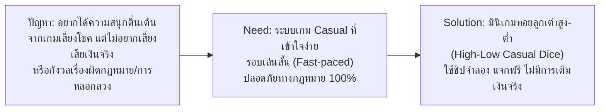
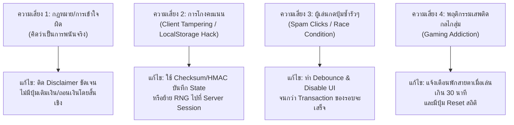

# เอกสารวิเคราะห์ความต้องการระบบ (Software Requirements Specification)
## ระบบ: มินิเกมง่าย ๆ แนวพนันไม่ลงเงินจริง (Play-Money Casual Mini-Game)

> **มาตรฐาน:** ดำเนินการวิเคราะห์ตามทักษะ **01-requirements-engineering**  
> **หมวดหมู่ผลิตภัณฑ์:** Casual Simulator / Entertainment Web-Mobile App  
> **เวอร์ชัน:** 1.0.0  
> **สถานะ:** Draft for Architecture & Design  

---

## 1. การวิเคราะห์ปัญหาและความต้องการ (Problem & Need Statement)



### 1.1 Problem Statement
- **Pain Points:** 
  1. ผู้ใช้จำนวนมากชื่นชอบความตื่นเต้นจากกลไก "ความเสี่ยงและผลตอบแทน (Risk-Reward)" และเกมแนวเสี่ยงทาย (สุ่มลูกเต๋า, หมุนวงล้อ, ทายไพ่) เพื่อคลายเครียดในเวลาว่าง
  2. เกมการพนันออนไลน์ทั่วไปมีความเสี่ยงสูงเรื่องการสูญเสียทรัพย์สินจริง มีความเสี่ยงต่อการเสพติด มีการฉ้อโกง และผิดกฎหมายในหลายเขตอำนาจศาล (รวมถึงประเทศไทย)
  3. เกมคาสิโนโซเชียลหลายเกมในตลาดยังมีกลไก "In-App Purchases" กดดันให้ผู้เล่นเติมเงินซื้อเหรียญเมื่อชิปหมด (Pay-to-continue dark patterns)

### 1.2 Core Need
- ต้องการระบบมินิเกมที่ให้ **ความรู้สึกตื่นเต้นแบบเดียวกัน (Simulated Thrill)** 
- เล่นจบได้ในเวลารวดเร็ว (30 วินาที - 1 นาทีต่อรอบ)
- เข้าเล่นได้ทันทีโดยไม่ต้องผ่านขั้นตอนลงทะเบียนที่ยุ่งยาก
- **ไม่มีการนำเงินจริงเข้ามาเกี่ยวข้องทั้งทางตรงและทางอ้อม (Zero Monetary Value Guarantee)** และมีกลไกป้องกันชิปหมดแบบเล่นได้ตลอดกาล (Unlimited Playability)

### 1.3 Proposed Solution
สร้าง **"High-Low Casual Dice Mini-Game" (เกมลูกเต๋าสูง-ต่ำจำลองเล่นเพลิน)**:
- เล่นด้วย **Play Money (ชิปจำลอง)** 100%
- มีระบบแจกชิปเริ่มต้น, โบนัสล็อกอินรายวัน (Daily Faucet), และระบบช่วยเหลือเมื่อชิปหมด (Bankruptcy Bailout) ทันที
- รูปแบบเกมเข้าใจง่าย: ทายผลลูกเต๋า 3 ลูก (สูง: 11-17, ต่ำ: 4-10, หรือแต้มพิเศษ)
- บันทึกสถิติและความสำเร็จ (Win Streak, Win Rate) เพื่อสร้างความท้าทายแทนเงินรางวัล

---

## 2. ขอบเขตของระบบ (Project Scope)

### 2.1 In Scope (สิ่งที่อยู่ในขอบเขต)
1. **ระบบชิปจำลอง (Virtual Currency Management):**
   - แจกชิปเริ่มต้นสำหรับผู้เล่นใหม่ (Initial Free Chips)
   - ระบบกดรับชิปฟรีรายวัน (Daily Login Bonus)
   - ระบบช่วยเหลือฉุกเฉินเมื่อชิปหมด (Emergency Bailout / Tap to Refill)
2. **ระบบการเล่นเกมหลัก (Core Gameplay: High-Low Dice):**
   - เลือกระดับเดิมพันชิป (Bet Selector)
   - เลือกหน้าแทง: ต่ำ (Low: 4-10), สูง (High: 11-17), หรือเต๋าตอง (Triple)
   - อนิเมชันทอยเต๋า 3 ลูก พร้อมเสียงประกอบ (Toggle Sound On/Off)
   - สรุปผลการเล่นทันที (Win/Loss Overlay, Multiplier Calculation)
3. **ระบบสถิติและประวัติ (History & Statistics):**
   - ประวัติผลลูกเต๋า 10-20 รอบล่าสุด (Recent Dice Results Roadmap)
   - สรุปสถิติผู้เล่น (อัตราการชนะ Win Rate, สถิติชนะติดต่อกันสูงสุด Best Streak)
4. **ระบบความเข้ากันได้และการบันทึกข้อมูล (Persistence & Compatibility):**
   - เล่นได้ทันทีผ่าน Web Browser ทั้งบนเดสก์ท็อปและสมาร์ตโฟน (Responsive Web App)
   - บันทึกสถานะผู้เล่นผ่าน Local Storage / IndexedDB (หรือ Guest Session)
5. **ข้อกำหนดความปลอดภัยและกฎหมาย (Compliance Disclaimer):**
   - ป้ายประกาศชี้แจง (Disclaimer Banner) ชัดเจนว่า "เกมเพื่อความบันเทิง ไม่มีการใช้เงินจริง ไม่สามารถแลกของรางวัลใดๆ ได้"

### 2.2 Out of Scope (สิ่งที่ไม่อยู่ในขอบเขต)
1. **ระบบเงินจริงทั้งหมด (No Real-Money Transactions):**
   - ไม่มีช่องทางเชื่อมต่อ Payment Gateway (ไม่มีโอนเงิน, บัตรเครดิต, TrueMoney, PromptPay, Crypto)
   - ไม่มีการถอนเงิน (Withdrawal) หรือแลกเปลี่ยนเป็นของรางวัลที่มีมูลค่าในชีวิตจริง
2. **ระบบโอนชิประหว่างผู้เล่น (No P2P Chip Transfer):**
   - ป้องกันการสร้างตลาดมืด (Secondary Black Market) เพื่อซื้อขายชิปนอกระบบ
3. **ระบบ Multi-player Real-time ห้องใหญ่:**
   - มุ่งเน้น Single Player Arcade Mode หรือ Asynchronous Board เพื่อลดความซับซ้อนของ Server และตัดปัญหาเรื่อง collusion (การฮั้วกัน)

---

## 3. ผู้มีส่วนได้ส่วนเสีย (Stakeholders & Personas)

| ผู้มีส่วนได้ส่วนเสีย | บทบาทและความต้องการหลัก | ความคาดหวังต่อระบบ |
| :--- | :--- | :--- |
| **Casual Player (ผู้เล่นทั่วไป)** | ผู้เล่นที่ต้องการหาเกมเล่นฆ่าเวลา คลายเครียด 1-5 นาที | โหลดไว เล่นง่าย ไม่ต้องสมัครสมาชิก ชิปหมดแล้วมีให้กดเล่นต่อได้ฟรี |
| **Simulated-Gambling Fan** | ผู้ที่ชอบทายผล สถิติ และกราฟ Roadmap ลูกเต๋า | กฎกติกาเป็นธรรม ผลสุ่มมีมาตรฐาน แสดงสถิติย้อนหลังชัดเจน |
| **Product / System Owner** | ผู้สร้างเกมที่ต้องการยอด Engagement สูง โดยไม่มีปัญหาข้อกฎหมาย | ไม่มีภาระทางกฎหมายการพนัน ค่าใช้จ่ายเซิร์ฟเวอร์ต่ำ บำรุงรักษาง่าย |
| **Legal / Compliance** | ผู้ตรวจสอบความถูกต้องตามกฎหมาย | ชิปไม่มีมูลค่าทางเศรษฐกิจ (Zero-Monetary Value) ไม่เข้าข่ายการพนันตามกฎหมาย |

---

## 4. ความต้องการเชิงฟังก์ชัน (Functional Requirements - FR)

### หมวด 1: ระบบชิปจำลองและเศรษฐกิจในเกม (Virtual Wallet & Economy)
- **FR-01 (Initial Grants):** เมื่อผู้ใช้เข้าสู่ระบบครั้งแรก ระบบต้องให้ชิปเริ่มต้นฟรีจำนวน 1,000 ชิปโดยอัตโนมัติ
- **FR-02 (Daily Bonus Faucet):** ผู้ใช้สามารถกดรับชิปโบนัสประจำวันได้วันละ 1 ครั้ง จำนวน 500 ชิป โดยมีตัวนับเวลาถอยหลัง (Cooldown timer) แจ้งเตือนรอบถัดไป
- **FR-03 (Bankruptcy Bailout):** เมื่อชิปคงเหลือของผู้ใช้ลดลงต่ำกว่า 10 ชิป (ยอดเดิมพันขั้นต่ำ) ระบบต้องแสดงปุ่ม "ขอรับชิปฉุกเฉิน (Bailout)" เพื่อเติมชิปให้ทันที 200 ชิป (จำกัด Cooldown 1 นาที ป้องกันการกดสแปม)
- **FR-04 (Wallet Balance Display):** หน้าจอต้องแสดงยอดชิปคงเหลือของผู้เล่นแบบ Real-time มีอนิเมชันนับแต้มขึ้น/ลงตามผลการเล่น

### หมวด 2: กลไกการเล่นเกม (Core Gameplay & Betting)
- **FR-05 (Bet Amount Selection):** ผู้เล่นสามารถเลือกจำนวนชิปที่ต้องการเดิมพันได้ (เช่น ปุ่มลัด 10, 50, 100, 500 หรือพิมพ์จำนวนเอง) โดยต้องไม่เกินชิปคงเหลือที่มี
- **FR-06 (Bet Type Selection):** ผู้เล่นสามารถเลือกวางเดิมพันในตัวเลือกที่กำหนดได้ ได้แก่:
  - **ต่ำ (Low):** ผลรวมลูกเต๋า 3 ลูกเท่ากับ 4 ถึง 10 (ไม่รวมเต๋าตอง)
  - **สูง (High):** ผลรวมลูกเต๋า 3 ลูกเท่ากับ 11 ถึง 17 (ไม่รวมเต๋าตอง)
  - **เต๋าตอง (Triple/Any Triple):** ลูกเต๋าทั้ง 3 ลูกออกแต้มเหมือนกันทั้งหมด (เช่น 1-1-1, 2-2-2)
- **FR-07 (Clear / Rebet Controls):** ผู้เล่นสามารถกดยกเลิกเดิมพัน (Clear Bet) หรือกดเดิมพันซ้ำยอดเดิม (Re-bet) ได้ก่อนเริ่มหมุน
- **FR-08 (Roll Dice Action):** ผู้เล่นกดปุ่ม "ทอยเต๋า (Roll)" เพื่อยืนยันการเดิมพัน ระบบจะหักชิปเดิมพันออกจากกระเป๋าทันที และเริ่มแสดงอนิเมชันการเขย่า/ทอยลูกเต๋า

### หมวด 3: ระบบสุ่มผลลัพธ์และคำนวณรางวัล (RNG & Payout Resolution)
- **FR-09 (Provably Fair / Secure RNG):** ระบบต้องใช้การสุ่มค่าตัวเลข (RNG) ที่มีการกระจายตัวของความน่าจะเป็นเท่าเทียมกัน (Uniform Distribution) สำหรับลูกเต๋าแต่ละลูก (แต้ม 1-6)
- **FR-10 (Payout Calculation):** คำนวณผลและจ่ายชิปรางวัลตาม Business Rules (BR-03):
  - แทง Low ชนะ: จ่าย 1:1 (รับทุนคืน + กำไร 1 เท่า)
  - แทง High ชนะ: จ่าย 1:1 (รับทุนคืน + กำไร 1 เท่า)
  - แทง Triple ชนะ: จ่าย 30:1 (รับทุนคืน + กำไร 30 เท่า)
  - แทง High/Low แต่ออกลูกเต๋าตอง (เช่น 3-3-3 = 9 หรือ 4-4-4 = 12): ถือว่าเจ้ามือชนะ (House Edge Rules)
- **FR-11 (Result Modal & Celebration):** แสดงผลลัพธ์ลูกเต๋าทั้ง 3 ลูก, ผลรวมแต้ม, สรุปสถานะ (ชนะ/แพ้) และยอดชิปที่ได้รับสุทธิ

### หมวด 4: สถิติและประวัติการเล่น (History & Streak Tracking)
- **FR-12 (Dice History Roadmap):** แสดงรายการผลการออกรางวัลย้อนหลังอย่างน้อย 15 รอบล่าสุด (เช่น สัญลักษณ์ L=ต่ำ, H=สูง, T=ตอง)
- **FR-13 (User Statistics Dashboard):** แสดงสถิติการเล่นสะสมของผู้ใช้ ได้แก่:
  - จำนวนรอบที่เล่นทั้งหมด (Total Games Played)
  - อัตราการชนะ (Win Rate %)
  - สถิติชนะต่อเนื่องสูงสุด (Max Win Streak)
  - กำไรชิปสูงสุดในรอบเดียว (Biggest Win)

### หมวด 5: การตั้งค่าและการปฏิบัติตามกฎหมาย (Settings & Compliance)
- **FR-14 (Audio & Haptic Feedback):** ผู้เล่นสามารถเปิด-ปิดเสียงประกอบ (Sound Effects) และเสียงดนตรี (BGM) ได้
- **FR-15 (Legal Disclaimer Display):** ต้องแสดงข้อความคำเตือนถาวรหรือสามารถเข้าดูได้ง่ายในหน้าจอ ระบุชัดเจนว่า "เกมจำลองเพื่อความสนุกสนาน ไม่ใช่การพนันจริง ชิปไม่มีมูลค่าเงินจริง"
- **FR-16 (Reset Game Data):** มีตัวเลือกให้ผู้เล่นกด "ล้างข้อมูลเกม (Reset Game)" เพื่อเริ่มต้นใหม่ที่ 1,000 ชิปได้หากต้องการ

---

## 5. ความต้องการที่ไม่ใช่เชิงฟังก์ชัน (Non-Functional Requirements - NFR)

| รหัส | มิติ (Attribute) | ข้อกำหนด (Specification) | เกณฑ์การวัดผล (Metric) |
| :--- | :--- | :--- | :--- |
| **NFR-01** | **Performance** | เวลาประมวลผลตั้งแต่กด Roll จนแสดงผลลูกเต๋าหยุดหมุนไม่เกิน 1.5 วินาที (รวม Animation) | Latency ในการประมวลผลลัพธ์ < 100ms |
| **NFR-02** | **Integrity** | ป้องกันการแก้ไขชิปหรือดัดแปลงผลการทอยผ่าน JavaScript Console หรือ DevTools (กรณีเชื่อมต่อ Backend) | ตรวจสอบผลลัพธ์และยอดชิปที่ Server หรือมี Checksum/Hash Validation |
| **NFR-03** | **Usability** | หน้าจอถูกออกแบบตามแนวคิด Mobile-first รองรับการใช้งานมือเดียว (One-thumb control) | รองรับหน้าจอ 360px ขึ้นไป (Responsive Design) |
| **NFR-04** | **Reliability** | ข้อมูลชิป ประวัติ และสถิติไม่สูญหายเมื่อผู้เล่นรีเฟรชหน้าเว็บ หรือปิดบราวเซอร์ | LocalStorage / IndexedDB Auto-sync ทุกรอบการเล่น |
| **NFR-05** | **Accessibility** | คอนทราสต์ของสีหน้าจอแสดงผลและตัวเลขลูกเต๋าชัดเจน สัญลักษณ์ไม่พึ่งพาเพียงสีแดง/เขียว | ผ่านมาตรฐาน WCAG 2.1 AA ด้าน Color Contrast |
| **NFR-06** | **Compliance & Ethics** | ห้ามมี Dark Pattern หรือกลไกหลอกล่อให้ผู้เล่นแลกเปลี่ยนเงินจริงเข้ามาในระบบ | ผ่านการตรวจ Code Review 100% ว่าไม่มี Payment API หรือ Cashout API |

---

## 6. กฎทางธุรกิจและข้อจำกัด (Business Rules & Constraints)

### 6.1 Business Rules (BR)
- **BR-01 (Initial Capital):** ผู้เล่นใหม่ทุกคนจะได้รับชิปขวัญถุงเริ่มต้น 1,000 ชิป
- **BR-02 (Bet Limits):**
  - เดิมพันขั้นต่ำต่อรอบ: 10 ชิป
  - เดิมพันสูงสุดต่อรอบ: ไม่เกิน 500 ชิป หรือไม่เกินยอดชิปปัจจุบันที่มี (เลือกค่าน้อยกว่า) เพื่อป้องกันผู้เล่นหมดตัวในรอบเดียวและคงความสนุกของเกม
- **BR-03 (Game Mechanics & Payout Table):**
  - ลูกเต๋า 3 ลูก แต่ละลูกมีแต้ม 1 ถึง 6 ผลรวมแต้มอยู่ระหว่าง 3 ถึง 18
  - **ต่ำ (Low):** แต้มรวม 4 ถึง 10 (อัตราจ่าย 1 : 1)
  - **สูง (High):** แต้มรวม 11 ถึง 17 (อัตราจ่าย 1 : 1)
  - **ตอง (Triple):** ลูกเต๋าออกเลขเดียวกันทั้ง 3 ลูก (1-1-1 ถึง 6-6-6) เช่น แต้ม 3 (1-1-1) หรือแต้ม 18 (6-6-6) หรือแต้มอื่นที่ออกตอง
    - หากออกตอง ผู้ที่แทง High หรือ Low จะถือว่าแพ้ (House Rules ตามหลักสากล)
    - ผู้ที่แทงช่อง "Triple" จะได้รับอัตราจ่าย 30 : 1
- **BR-04 (Bailout Refill Rule):**
  - สิทธิ์ขอรับชิปฟรีฉุกเฉินจะปลดล็อกเมื่อยอดชิปคงเหลือ < 10 ชิป
  - ให้ชิปฟรี 200 ชิปต่อครั้ง
  - มีระยะเวลาหน่วง (Cooldown) 60 วินาทีต่อการขอรับ 1 ครั้ง
- **BR-05 (Zero Real-World Value):**
  - ชิปในเกมคือหน่วยแต้มคะแนนสมมติ (In-game Points)
  - ห้ามมีการซื้อ-ขาย แลกเปลี่ยนเป็นเงิน โอนสิทธิ์ หรือแลกเปลี่ยนเป็นของรางวัลใดๆ นอกเกมทั้งสิ้น

### 6.2 Constraints & Assumptions
- **Constraint-01:** ระบบต้องสามารถรันแบบ Standalone Client-side ได้อย่างสมบูรณ์ หรือทำงานร่วมกับ Lightweight Backend
- **Constraint-02:** ไม่ต้องมีการยืนยันตัวตนด้วยเบอร์โทรศัพท์หรือบัตรประชาชน (No KYC Required) เพื่อรักษาความเป็นมินิเกมเล่นง่าย
- **Assumption-01:** ผู้เล่นยอมรับว่าชิปจำลองสามารถถูกรีเซ็ตหรือล้างได้หากมีการล้าง Browser Cache

---

## 7. กรณีการใช้งานและเกณฑ์การยอมรับ (User Stories & Acceptance Criteria)

### US-01: การเริ่มต้นเล่นเกมของผู้ใช้ใหม่ (First-time Onboarding)
> **As a** ผู้เล่นใหม่  
> **I want to** ได้รับชิปจำลองฟรีทันทีเมื่อเปิดเกม  
> **So that** ฉันสามารถเริ่มทดลองเล่นเกมได้ทันทีโดยไม่ต้องลงทะเบียนหรือจ่ายเงิน  

#### Acceptance Criteria (AC-01):
```gherkin
Feature: First-time Onboarding & Initial Grant
  Scenario: New player opens the game for the first time
    Given ผู้เล่นเปิดเข้าหน้าเว็บเกมเป็นครั้งแรก (ยังไม่มีข้อมูลในเครื่อง)
    When หน้าจอเกมโหลดเสร็จสมบูรณ์
    Then ระบบต้องบันทึกสถานะผู้เล่นใหม่
    And ยอดชิปคงเหลือเริ่มต้นต้องแสดงเป็น 1,000 ชิป
    And ต้องแสดงหน้าต่างต้อนรับอธิบายวิธีเล่นสั้นๆ พร้อมข้อความชี้แจง "เกมนี้เล่นเพื่อความบันเทิง ไม่ใช้เงินจริง"
```

---

### US-02: การวางเดิมพันและการทอยลูกเต๋า (Placing Bet & Rolling)
> **As a** ผู้เล่น  
> **I want to** เลือกตัวเลือก สูง/ต่ำ และกำหนดจำนวนชิปที่ต้องการเดิมพัน  
> **So that** ฉันสามารถสนุกกับการทายผลลูกเต๋าได้ตามใจชอบ  

#### Acceptance Criteria (AC-02):
```gherkin
Feature: Bet Placement & Dice Rolling
  Scenario: Valid Bet on "Low"
    Given ผู้เล่นมียอดชิปคงเหลือ 500 ชิป
    When ผู้เล่นเลือกจำนวนเดิมพัน 50 ชิป
    And ผู้เล่นคลิกเลือกแทงที่ช่อง "ต่ำ (Low)"
    And ผู้เล่นกดปุ่ม "ทอยเต๋า (Roll)"
    Then ยอดชิปคงเหลือของผู้เล่นต้องถูกหักทันที 50 ชิป (เหลือ 450 ชิป)
    And ปุ่มวางเดิมพันและปุ่ม Roll ต้องถูกปิดการใช้งาน (Disabled) ระหว่างที่ลูกเต๋ากำลังหมุน
    And มีอนิเมชันลูกเต๋าหมุนเป็นเวลาประมาณ 1-1.5 วินาที

  Scenario: Insufficient chips to bet
    Given ผู้เล่นมียอดชิปคงเหลือ 30 ชิป
    When ผู้เล่นพยายามเลือกเดิมพัน 50 ชิป
    Then ระบบต้องไม่อนุญาตให้เดิมพันจำนวนนั้น
    And แสดงข้อความแจ้งเตือน "ยอดชิปไม่เพียงพอ"
```

---

### US-03: การตัดสินผลและการจ่ายชิปรางวัล (Result Resolution & Virtual Payout)
> **As a** ผู้เล่น  
> **I want to** รู้ผลแพ้ชนะและได้รับชิปจำลองเพิ่มเมื่อทายถูก  
> **So that** ฉันได้รับความสนุกและสะสมชิปได้เพิ่มขึ้น  

#### Acceptance Criteria (AC-03):
```gherkin
Feature: Result Evaluation & Payout
  Scenario: Player wins High-Low bet
    Given ผู้เล่นวางเดิมพันช่อง "สูง (High)" จำนวน 100 ชิป
    When ลูกเต๋าหยุดหมุนและออกแต้ม 4, 5, 6 (ผลรวมเท่ากับ 15)
    Then ระบบต้องตัดสินว่าผลลัพธ์คือ "สูง (High)"
    And ผู้เล่นต้องได้รับชิปเงินรางวัลสุทธิ 200 ชิป (คืนทุน 100 + กำไร 100)
    And ยอดชิปสะสมต้องเพิ่มขึ้น 200 ชิป
    And แสดงหน้าต่างผลลัพธ์พร้อมข้อความ "ยินดีด้วย คุณชนะ!" และเสียงเอฟเฟกต์แห่งชัยชนะ

  Scenario: Player loses because of a Triple (House Edge)
    Given ผู้เล่นวางเดิมพันช่อง "ต่ำ (Low)" จำนวน 100 ชิป
    When ลูกเต๋าหยุดหมุนและออกแต้ม 2, 2, 2 (ผลรวมเท่ากับ 6 แต่ออกตอง)
    Then ระบบต้องตัดสินว่าผลลัพธ์คือ "ตอง (Triple)"
    And ผู้เล่นที่แทง Low ถือว่าแพ้ ไม่ได้รับชิปคืน
    And แสดงผลลัพธ์ "ลูกเต๋าออกตอง เจ้ามือชนะ"
```

---

### US-04: การขอรับชิปช่วยเหลือฉุกเฉินเมื่อชิปหมด (Bankruptcy Bailout)
> **As a** ผู้เล่นที่เล่นจนชิปหมด  
> **I want to** กดรับชิปช่วยเหลือฟรีได้ทันที  
> **So that** ฉันสามารถเล่นเกมต่อได้โดยไม่เจอตันและไม่ต้องควักเงินจริงมาเติม  

#### Acceptance Criteria (AC-04):
```gherkin
Feature: Emergency Bailout
  Scenario: Chips drop below minimum bet
    Given ผู้เล่นมียอดชิปคงเหลือ 5 ชิป (ต่ำกว่าเดิมพันขั้นต่ำ 10 ชิป)
    When ผู้เล่นดูที่หน้าจอ
    Then ระบบต้องแสดงปุ่ม "ขอรับชิปฉุกเฉิน (+200)" อย่างเด่นชัด
    When ผู้เล่นกดปุ่ม "ขอรับชิปฉุกเฉิน"
    Then ยอดชิปต้องเพิ่มขึ้น 200 ชิปทันที (กลายเป็น 205 ชิป)
    And ปุ่มขอรับชิปฉุกเฉินต้องเปลี่ยนเป็นตัวนับเวลาถอยหลัง 60 วินาที (Cooldown)
```

---

### US-05: การกดรับโบนัสล็อกอินประจำวัน (Daily Bonus)
> **As a** ผู้เล่นที่กลับมาเล่นเป็นประจำ  
> **I want to** เคลมชิปโบนัสรายวัน  
> **So that** ฉันมีชิปสะสมเพิ่มขึ้นเพื่อใช้เล่นในแต่ละวัน  

#### Acceptance Criteria (AC-05):
```gherkin
Feature: Daily Login Bonus
  Scenario: Claim daily bonus when eligible
    Given ผู้เล่นล็อกอินเข้าเกมในวันใหม่ (ผ่านไปเกิน 24 ชั่วโมงจากการเคลมครั้งก่อน)
    When ผู้เล่นกดปุ่ม "รับโบนัสประจำวัน"
    Then ยอดชิปของผู้เล่นต้องเพิ่มขึ้น 500 ชิป
    And ระบบบันทึกเวลาที่กดรับล่าสุด
    And ปุ่มต้องแสดงสถานะ "รับแล้ว" พร้อมเวลานับถอยหลังถึงวันถัดไป
```

---

### US-06: การดูประวัติและสถิติการเล่น (Viewing Statistics)
> **As a** ผู้เล่น  
> **I want to** ดูประวัติการออกหน้าเต๋าและสถิติของตัวเอง  
> **So that** ฉันสามารถดูแนวโน้มและวิเคราะห์การเล่นรอบต่อไปได้  

#### Acceptance Criteria (AC-06):
```gherkin
Feature: Statistics and Roadmap Tracking
  Scenario: Roadmap updates after every game round
    Given รอบการเล่นปัจจุบันเสร็จสิ้น (ลูกเต๋าออกแต้ม 3-4-5 รวม 12 = High)
    When ระบบสรุปผลเรียบร้อย
    Then กระดาน Roadmap ผลย้อนหลังต้องเพิ่มผล "H (12)" เข้าไปที่ช่องล่าสุด
    And จำนวนเกมทั้งหมดใน Dashboard สถิติต้องเพิ่มขึ้น 1
    And อัตราการชนะ (Win Rate) และ Win Streak ต้องถูกคำนวณและแสดงผลใหม่ทันที
```

---

## 8. การวิเคราะห์ความเสี่ยงและมาตรการรับมือ (Risks & Mitigations)



| รหัส | ความเสี่ยง (Risk Event) | ผลกระทบ (Impact) | โอกาสเกิด (Likelihood) | มาตรการป้องกัน/แก้ไข (Mitigation Strategy) |
| :--- | :--- | :--- | :--- | :--- |
| **RSK-01** | **ข้อพิพาททางกฎหมาย (Legal Misunderstanding):** ถูกมองว่าเป็นแพลตฟอร์มการพนันออนไลน์ผิดกฎหมาย | สูง | ต่ำ | ติดข้อความ Disclaimer ชัดเจนในทุกหน้า ไม่ใส่คำว่า "ฝาก-ถอน" หรือ "เติมเงิน" ไม่มีการเชื่อมต่อกับเงินจริงใดๆ ทั้งสิ้น |
| **RSK-02** | **การแก้ไขข้อมูลในเครื่อง (Client-side Data Tampering):** ผู้เล่นใช้ Developer Console แก้จำนวนชิปใน LocalStorage | กลาง | สูง | เข้ารหัส/แฮชข้อมูลชิปคู่กับ salt ก่อนบันทึก หรือหากต้องการความน่าเชื่อถือสูง ให้ใช้ Lightweight Backend API เป็นผู้เก็บบันทึกยอดชิป |
| **RSK-03** | **การกดซ้ำรัวๆ (Rapid Spamming / Double Roll):** ผู้เล่นกดย้ำปุ่ม Roll ขณะกำลังประมวลผล ทำให้หักชิปเบิ้ลหรือระบบค้าง | กลาง | สูง | ทำ Debounce ที่ปุ่ม และสั่ง Disable การกดทันทีที่ส่งคำสั่ง รอจนกว่า State ของรอบจะกลับสู่ Idle |
| **RSK-04** | **การสูญหายของ State ระหว่างทอย (Disconnection/Refresh):** ผู้เล่นกดรีเฟรชหน้าเว็บขณะที่เต๋ากำลังทอย | ต่ำ | ปานกลาง | บันทึก State การทอยเป็น Transaction: หากเกิดการรีเฟรช ให้ระบบ Resolve ผลลัพธ์และอัปเดตยอดคงเหลืออัตโนมัติ |
| **RSK-05** | **พฤติกรรมการเล่นที่ไม่เหมาะสม (Responsible Gaming):** ผู้เล่นเล่นต่อเนื่องนานเกินไปจนเสียการเรียน/การทำงาน | กลาง | ปานกลาง | เพิ่มระบบเตือนเมื่อเล่นต่อเนื่องเกิน 30 นาที (Friendly Reminder) และไม่ใช้เสียงเตือนที่กระตุ้นความตึงเครียดเกินไป |

---

## 9. ตารางตรวจสอบย้อนกลับความต้องการ (Requirement Traceability Matrix - RTM)

ตารางนี้เชื่อมโยงระหว่าง **ปัญหาทางธุรกิจ (Need) -> ความต้องการเชิงฟังก์ชัน (FR) -> เรื่องราวผู้ใช้ (US) -> เกณฑ์การยอมรับ (AC) -> กฎธุรกิจ (BR) -> การทดสอบ (Verification Method)**

| Problem / Goal | FR ID | Non-Func | User Story | Acceptance Criteria | Business Rule | Verification Method |
| :--- | :--- | :--- | :--- | :--- | :--- | :--- |
| **PG-01:** เล่นฟรี ไม่ใช้เงินจริง ปลอดภัย | FR-01, FR-15 | NFR-06 | US-01 | AC-01 | BR-01, BR-05 | **Automated E2E Test:** ตรวจสอบยอดชิปเริ่มต้น 1,000 ชิป และตรวจสอบว่าไม่มี Request ไปยัง Payment Gateway |
| **PG-02:** ได้ความตื่นเต้นเหมือนเกมจริง | FR-05, FR-06, FR-08 | NFR-01, NFR-03 | US-02 | AC-02 | BR-02 | **Integration / UI Test:** ทดสอบเลือกชิป 50 แทง Low แล้วกด Roll ยอดชิปหักทันทีและลูกเต๋าหมุน |
| **PG-03:** กติกาเป็นธรรม รู้ผลไว | FR-09, FR-10, FR-11 | NFR-01, NFR-02 | US-03 | AC-03 | BR-03 | **Unit Test:** ทดสอบฟังก์ชัน RNG สุ่มแต้ม 1-6 และทดสอบตารางจ่าย Payout Matrix ครบทุกกรณี (High/Low/Triple) |
| **PG-04:** ชิปหมดเล่นต่อได้ตลอดกาล | FR-03 | NFR-04 | US-04 | AC-04 | BR-04 | **UI & State Test:** ปรับชิปให้เหลือ 0 ตรวจสอบว่าปุ่ม Bailout แสดงผล และเมื่อกดชิปเพิ่มเป็น 200 พร้อม Cooldown 60s |
| **PG-05:** ดึงดูดให้กลับมาเล่นซ้ำ | FR-02 | NFR-04 | US-05 | AC-05 | BR-01 | **Unit Test:** ทดสอบ Logic เวลาข้ามวัน 24 ชม. สามารถเคลม Daily 500 ชิปได้ |
| **PG-06:** วิเคราะห์สถิติและความท้าทาย | FR-12, FR-13 | NFR-03 | US-06 | AC-06 | BR-03 | **Unit & Regression Test:** ทดสอบการบันทึกลง History Array และการคำนวณ Win Rate / Streak อย่างถูกต้อง |
| **PG-07:** ป้องกันข้อพิพาทและการเสพติด | FR-14, FR-15 | NFR-05, NFR-06 | US-01 | AC-01 | BR-05 | **Manual Inspection & Audit:** ตรวจสอบข้อความ Disclaimer และปุ่มเปิด-ปิดเสียง |

---

## 10. สรุปและขั้นตอนแนะนำถัดไป (Next Steps)

1. **สถาปัตยกรรมระบบ (Architecture Design - Skill 03):** 
   - ออกแบบการแบ่ง Layer: UI Component (Dice, Bet Board, Stats) vs Logic State Store (Wallet, Game Engine, RNG)
2. **การออกแบบข้อมูล (Data Model - Skill 04):**
   - กำหนด Schema สำหรับจัดเก็บ Local Storage: `UserWallet`, `BetRecord`, `GameHistory`, `UserStats`
3. **การออกแบบ API / State Interface (Skill 05):**
   - กำหนด Contract ระหว่าง Frontend UI กับ Game Engine เช่น `placeBet(option, amount)`, `rollDice()`, `claimBailout()`, `claimDaily()`
