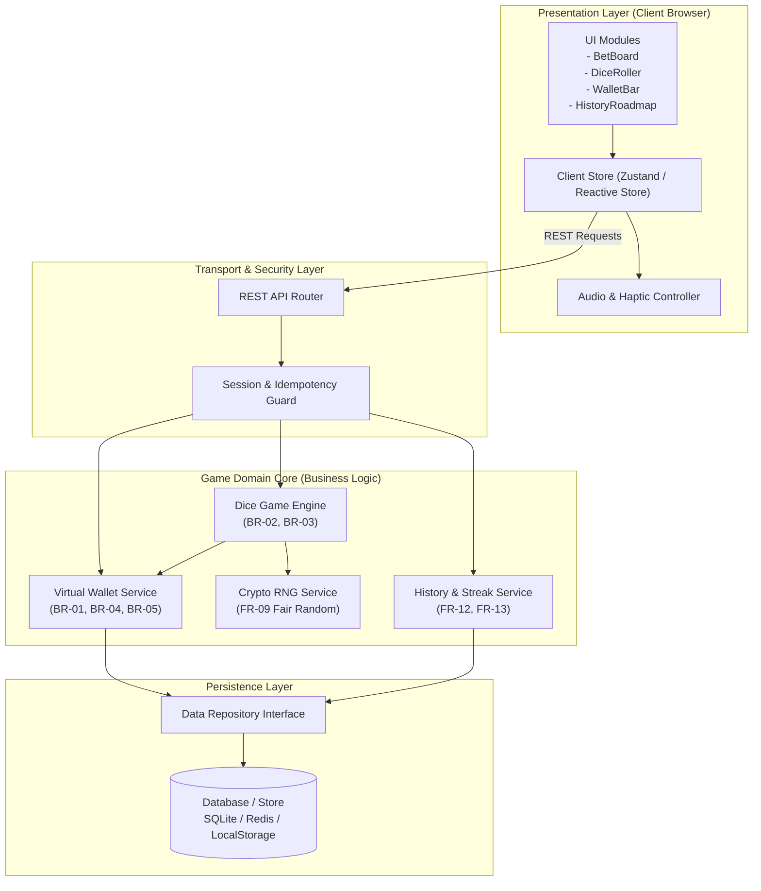
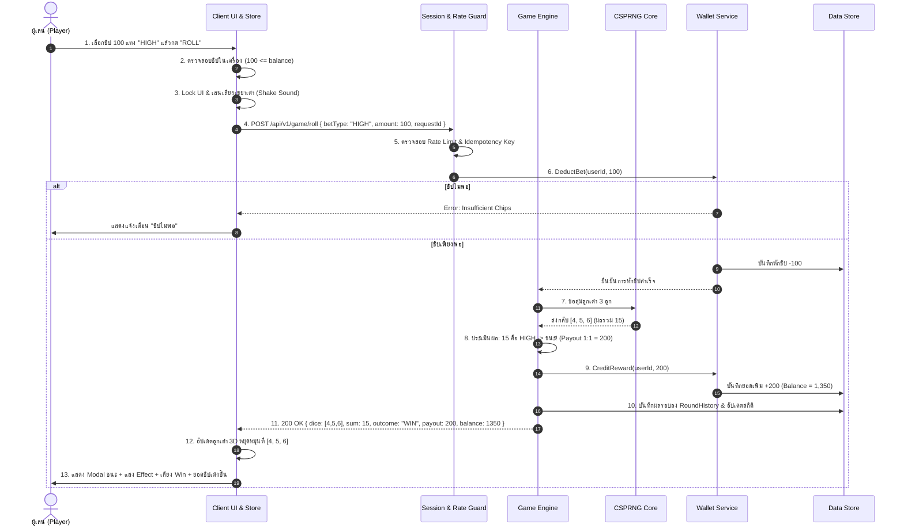
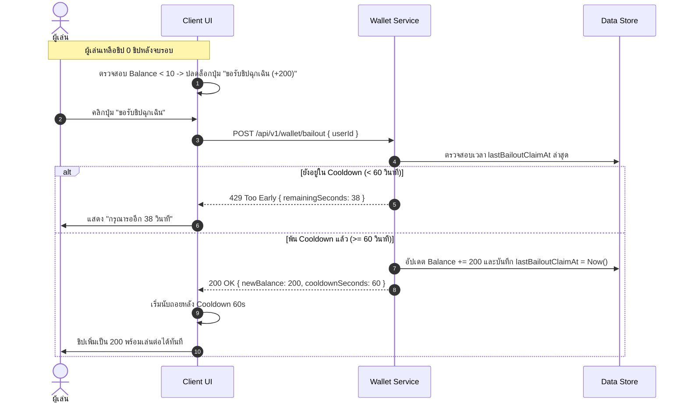
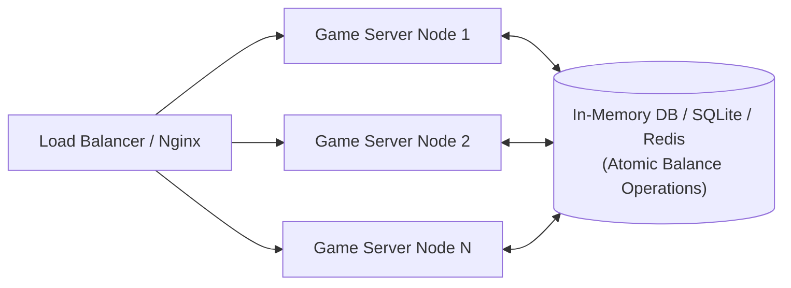
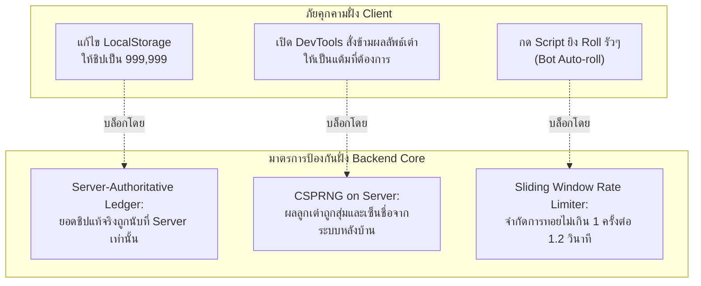

# เอกสารการออกแบบระบบเชิงสถาปัตยกรรม (System Design Specification)
## ระบบ: มินิเกมง่าย ๆ แนวพนันไม่ลงเงินจริง (Play-Money Casual High-Low Mini-Game)

> **มาตรฐาน:** ดำเนินการออกแบบตามทักษะ **02-system-design**  
> **อ้างอิงความต้องการ:** [requirements-mini-game.md](file:///home/loq15/.gemini/antigravity-cli/brain/4d9df3ab-5209-4418-be61-21642acd2755/requirements-mini-game.md)  
> **เวอร์ชัน:** 1.0.0  
> **สถานะ:** Ready for Architectural & Implementation Review  

---

## 1. บริบทของระบบและขอบเขตความไว้วางใจ (System Context & Trust Boundaries)

ระบบถูกออกแบบภายใต้หลักการ **"Play-Money Casual Architecture"** โดยเน้นความเรียบง่าย ประสิทธิภาพสูง รู้ผลไว ปลอดภัยทางกฎหมาย และป้องกันการดัดแปลงข้อมูลคะแนน (Tamper-Resistant)

```mermaid
flowchart TD
    subgraph UntrustedZone["โซนไม่ปลอดภัย (Untrusted Client Environment)"]
        User["ผู้เล่น (Casual Gamer)"]
        ClientApp["เว็บแอปพลิเคชัน / PWA<br/>(React / Vanilla Web UI)"]
        LocalStore[("เบราว์เซอร์ Storage<br/>(LocalStorage / Cache)")]
    end

    subgraph TrustBoundary["แนวแบ่งขอบเขตความปลอดภัย (Trust Boundary / API Gateway)"]
        RateLimiter["Rate Limiter & Input Sanitizer"]
    end

    subgraph TrustedZone["โซนปลอดภัย (Trusted Core Environment)"]
        GameServer["Game Application Server<br/>(Lightweight Node/Go/Python)"]
        RNG["CSPRNG Core<br/>(Cryptographically Secure RNG)"]
        WalletEngine["Virtual Ledger & Wallet Engine"]
        DataStore[("Persisted Storage / Cache<br/>(SQLite / Redis)")]
    end

    User -->|โต้ตอบผ่าน UI / แตะหน้าจอ| ClientApp
    ClientApp <-->|แคช UI State ออฟไลน์| LocalStore
    ClientApp -->|HTTP REST / JSON<br/>(Place Bet, Claim Free Chips)| RateLimiter
    RateLimiter -->|คำขอที่ผ่านการตรวจสอบ| GameServer
    GameServer <-->|สุ่มแต้มเต๋า 1-6 ที่ตรวจสอบได้| RNG
    GameServer <-->|บันทึกบัญชีชิป / ตรวจสอบสิทธิ์| WalletEngine
    WalletEngine <-->|อ่าน/เขียนประวัติและยอดคงเหลือ| DataStore
```

### 1.1 Actors & External Systems
1. **Casual Player (ผู้เล่นทั่วไป):** เข้าถึงผ่านเว็บเบราว์เซอร์บนมือถือหรือเดสก์ท็อป โดยไม่ต้องผ่านการลงทะเบียนแบบ KYC
2. **Client Web App (Frontend):** ทำหน้าที่เรนเดอร์ UI กระดานเดิมพัน, แสดงผลอนิเมชันลูกเต๋า 3D/CSS, เสียงประกอบ และจัดการ Local State
3. **Game Backend API (Trusted Service):** ทำหน้าที่เป็น Single Source of Truth สำหรับการคำนวณสุ่มผลเต๋า (RNG) และบัญชีกระเป๋าชิป เพื่อป้องกันการแฮกคะแนนผ่าน Console
4. **Offline Fallback Engine (กรณี Standalone Mode):** มี Local WebCrypto Engine ในตัวสำหรับรองรับการเล่นแบบออฟไลน์ 100%

---

## 2. สถาปัตยกรรมระดับสูง (High-Level Architecture)

ระบบใช้สถาปัตยกรรมแบบ **Layered Clean Architecture** ที่แยกส่วนการแสดงผล (Presentation), ส่วนประมวลผลคำขอ (API Transport), โดเมนของเกม (Game Domain Core) และส่วนจัดเก็บข้อมูล (Data Access) อย่างเด็ดขาด



---

## 3. การแยกย่อยคอมโพเนนต์และความรับผิดชอบ (Component Decomposition)

| Component | เลเยอร์ | ความรับผิดชอบหลัก (Single Responsibility) | Input | Output |
| :--- | :--- | :--- | :--- | :--- |
| **`BetBoard`** | Presentation | แสดงปุ่มชิป (10, 50, 100, 500) และช่องเลือกแทง (High, Low, Triple) ตรวจสอบยอดชิปก่อนอนุญาตให้กด | การแตะ/คลิกของผู้ใช้ | Action: `SET_BET(option, amount)` |
| **`DiceAnimator`** | Presentation | เรนเดอร์การทอยลูกเต๋า 3 ลูก ทั้งแบบ CSS 3D Cube หรือ Canvas พร้อมเสียงเขย่าและเสียงกระทบโต๊ะ | ผลลัพธ์แต้มลูกเต๋า `[d1, d2, d3]` | Animation Playback Completed Event |
| **`ClientStore`** | Presentation State | จัดการ State ชั่วคราวบนหน้าจอ: ยอดชิปที่แสดง, ประวัติรอบ, สถานะ UI (Idle, Rolling, Won, Lost) | Action จากผู้เล่น & ผลลัพธ์จาก API | State ปัจจุบันของ UI |
| **`SessionGuard`** | Transport | ตรวจสอบ Session Token ของ Guest, ป้องกัน Replay Attack ด้วย `client_request_id` (Idempotency) | HTTP Request + Headers | Validated Request Context |
| **`GameEngine`** | Domain Core | ตรวจสอบกฎการแทง (BR-02), ประเมินผลลูกเต๋าเทียบกับตัวเลือกที่แทง (BR-03), คำนวณ Payout Multiplier | `BetType`, `BetAmount`, `DiceResult` | `RoundOutcome { won, payout, delta }` |
| **`RNGService`** | Domain Core | สุ่มตัวเลข 1 ถึง 6 จำนวน 3 ลูก โดยใช้ Cryptographic Secure Random Generator (`crypto.randomInt` หรือ `crypto.getRandomValues`) | คำขอสุ่มเต๋า 3 ลูก | Array `[d1, d2, d3]` (แต่ละค่า 1-6) |
| **`WalletService`** | Domain Core | จัดการกระเป๋าชิปจำลอง: หักชิปเดิมพัน, เติมชิปรางวัล, ตรวจสอบสิทธิ์ Bailout (BR-04), เคลมโบนัสประจำวัน (BR-01) | `UserID`, `Amount`, `TransactionType` | `WalletState { balance, status }` |
| **`StatsService`** | Domain Core | บันทึกประวัติผลเต๋าย้อนหลัง 15 รอบ คำนวณ Win Rate %, Win Streak และ Biggest Win | `RoundResult` | `RoadmapArray`, `UserStats` |

---

## 4. โครงสร้างและการไหลของข้อมูล (Data Architecture & Flow)

### 4.1 Data Models (JSON / Schema Representation)

#### 1. กระเป๋าเงินจำลอง (`VirtualWallet`)
```json
{
  "sessionId": "guest_8a7f1c2d-9b3e",
  "balance": 1250,
  "lastDailyClaimAt": 1727600000000,
  "lastBailoutClaimAt": 1727601200000,
  "createdAt": 1727590000000
}
```

#### 2. บันทึกรอบการเล่น (`GameRoundRecord`)
```json
{
  "roundId": "rnd_550e8400-e29b-41d4-a716-446655440000",
  "sessionId": "guest_8a7f1c2d-9b3e",
  "requestId": "req_1727602000_abc1",
  "bet": {
    "type": "HIGH",
    "amount": 100
  },
  "dice": [4, 5, 6],
  "diceSum": 15,
  "isTriple": false,
  "outcome": "WIN",
  "multiplier": 1,
  "payout": 200,
  "netGain": 100,
  "balanceAfter": 1350,
  "timestamp": 1727602001500
}
```

#### 3. สถิติสะสม (`UserStatistics`)
```json
{
  "totalRounds": 42,
  "wins": 22,
  "losses": 20,
  "currentStreak": 3,
  "maxStreak": 5,
  "biggestWin": 500,
  "roadmap": ["H", "L", "L", "H", "H", "T", "H"]
}
```

---

## 5. แผนภาพลำดับการทำงาน (Sequence Flows)

### 5.1 Use Case 1: การวางเดิมพันและทอยลูกเต๋า (Bet Placement & Roll Resolution)



---

### 5.2 Use Case 2: การขอรับชิปช่วยเหลือฉุกเฉิน (Bankruptcy Bailout Flow)



---

## 6. แผนรองรับการขยายตัวและประสิทธิภาพ (Scalability & Performance)

### 6.1 Workload Profile (การประมาณการภาระงาน)
- **ประเภททราฟฟิก:** Read/Write Ratio อยู่ที่ประมาณ **1 : 1** (ทุกครั้งที่ทอยเต๋า จะมีการเขียน Transaction และอ่านผลลัพธ์)
- **ขนาดข้อมูลต่อรอบ:** Payload ขนาดเล็กมาก (< 1 KB ต่อ HTTP Request/Response)
- **Latency Budget:**
  - Round Computation (Server-side): `< 20ms`
  - Network Roundtrip (API): `< 80ms`
  - Client Animation: `1,000ms - 1,200ms` (หน่วงเพื่อความตื่นเต้น)
  - **รวมเวลาตอบสนองก่อนแสดงผลลัพธ์:** `< 1.5 วินาที` (ตรงตาม **NFR-01**)

### 6.2 Stateless Game Engine Design
- ตัว Game Server ออกแบบเป็น **Stateless Process** ไม่เก็บ Memory State ผูกกับ Node ใดโหนดหนึ่ง
- Session Token ใช้ JWT หรือ Signed Cookie ทำให้สามารถ Scale แบบ Horizontal ด้านหลัง Nginx / Reverse Proxy ได้อย่างไร้รอยต่อ



---

## 7. แผนรับมือความล้มเหลวและความพร้อมใช้งาน (Resilience & Failure Handling)

| สถานการณ์ความล้มเหลว (Failure Mode) | ผลกระทบ (Impact) | กลไกการตรวจจับและการกู้คืน (Recovery & Mitigation) |
| :--- | :--- | :--- |
| **Network Timeout ระหว่างกด Roll** | ผู้เล่นไม่แน่ใจว่าหักชิปไปแล้วหรือยัง ลูกเต๋าหมุนค้าง | **Idempotent Request Pattern:** ฝั่ง Client ส่ง `requestId` ไปด้วย หากเกิด Retry ฝั่ง Server จะคืนผลลัพธ์เดิม ไม่หักชิปซ้ำสอง |
| **ผู้เล่นกดปิดหรือรีเฟรชบราวเซอร์ขณะเต๋าหมุน** | หน้าจอดับลงระหว่างประมวลผล | เมื่อผู้เล่นเปิดหน้าเว็บกลับมา Client Store จะดึง State ล่าสุดจาก Server ยอดชิปและประวัติรอบที่เพิ่งออกจะปรากฏถูกต้อง |
| **Database Lock หรือ Storage ชั่วคราวไม่ตอบสนอง** | ไม่สามารถบันทึกรอบการเล่นได้ | มี **In-Memory Graceful Queue** พักบันทึกสถิติไว้ และ Rollback Transaction การหักชิปพร้อมส่งข้อความแจ้งเตือนผู้เล่น |
| **Client LocalStorage เสียหายหรือถูก Clear Cache** | ข้อมูลประวัติการเล่นในเครื่องหายไป | หากใช้งาน Guest Session สามารถสร้าง Guest Token ใหม่และมอบ Initial Grant 1,000 ชิปใหม่ทันทีตาม BR-01 |

---

## 8. การรักษาความมั่นคงปลอดภัยและการป้องกันการโกง (Security & Compliance)



1. **Server-Authoritative Balance:** ห้ามเชื่อยอดชิปที่ Client ส่งมาเด็ดขาด Client ส่งมาเฉพาะ `BetType` และ `BetAmount` เท่านั้น
2. **True CSPRNG:** ใช้ฟังก์ชันสุ่มที่มีความปลอดภัยทางวิทยาการรหัสลับ เช่น `crypto.randomInt(1, 7)` เพื่อไม่ให้ผู้เล่นสามารถคาดเดา Seed ล่วงหน้าได้
3. **Strict Compliance Sandbox:** ไม่มีการประกาศ Endpoint, Library, หรือ Webhook ใดๆ ที่เกี่ยวข้องกับ Payment Gateway / Credit Card / Cryptowallet โดยเด็ดขาด โค้ดผ่านการแยกแพ็กเกจ (Clean Dependency)

---

## 9. การประเมินข้อแลกเปลี่ยนในการออกแบบ (Design Trade-offs & Decision Matrix)

| ประเด็นการตัดสินใจ | ทางเลือกที่เลือก (Selected) | ทางเลือกอื่นที่พิจารณา (Alternative) | เหตุผลและข้อแลกเปลี่ยน (Rationale & Trade-off) |
| :--- | :--- | :--- | :--- |
| **สถาปัตยกรรม RNG** | **Server-side CSPRNG** (พร้อม Local-first Fallback) | Pure Client-side Math.random() | **ข้อดี:** ป้องกันการโกง 100%, สร้างความน่าเชื่อถือในผลสุ่ม<br/>**ข้อแลกเปลี่ยน:** ต้องมี Backend API รันอยู่เล็กน้อย (ใช้ทรัพยากรต่ำมาก) |
| **โพรโทคอลการเชื่อมต่อ** | **HTTP REST + JSON** | WebSocket Full-duplex | **ข้อดี:** เรียบง่าย, ไร้สถานะ (Stateless), Scale ง่าย ไม่ต้องดูแล Connection Pool สำหรับเกมแนว Single-player<br/>**ข้อแลกเปลี่ยน:** มี HTTP Header Overhead เล็กน้อย (แต่ < 1KB ไม่เป็นปัญหา) |
| **ระบบฐานข้อมูล** | **Lightweight Embedded DB (SQLite / Local Cache)** | Distributed DB (PostgreSQL / MongoDB) | **ข้อดี:** Setup ไว ไม่กิน RAM รองรับทราฟฟิกมินิเกมได้นับหมื่นรอบต่อวันได้อย่างสบาย<br/>**ข้อแลกเปลี่ยน:** ไม่เหมาะกับระบบที่มีผู้เล่นพร้อมกันระดับแสนคนในวินาทีเดียว (ซึ่งเกินขอบเขตมินิเกม) |
| **การเรนเดอร์ลูกเต๋า** | **CSS 3D Transforms / Canvas 2D** | Heavy WebGL 3D (Three.js / Babylon.js) | **ข้อดี:** ขนาดบันเดิลเล็ก (< 50KB), โหลดเสร็จใน 1 วินาที, รองรับมือถือรุ่นประหยัดได้อย่างลื่นไหล 60 FPS<br/>**ข้อแลกเปลี่ยน:** ลูกเต๋าอาจไม่ได้สมจริงระดับ 3D Physics Engine แต่เพียงพอต่อความสนุกของเกมสไตล์ Casual |

---

## 10. สรุปความพร้อมสำหรับขั้นตอนถัดไป (Traceability to Next Skills)

- สถาปัตยกรรมนี้รองรับข้อกำหนดจาก **Skill 01** ได้ครบถ้วนทุกข้อ (FR-01 ถึง FR-16 และ NFR-01 ถึง NFR-06)
- **ขั้นตอนถัดไป:**
  1. **Software Architecture (Skill 03):** ออกแบบโครงสร้าง Codebase, Folder Structure, และ Clean Architecture Interfaces
  2. **Database Design (Skill 04):** จัดทำ Database Schema, Indexing และ Migration DDL สำหรับ Session, Wallet Transaction และ Round History
  3. **API Design (Skill 05):** ออกแบบ OpenAPI / Swagger Contract สำหรับ Endpoints ของเกมอย่างละเอียด
