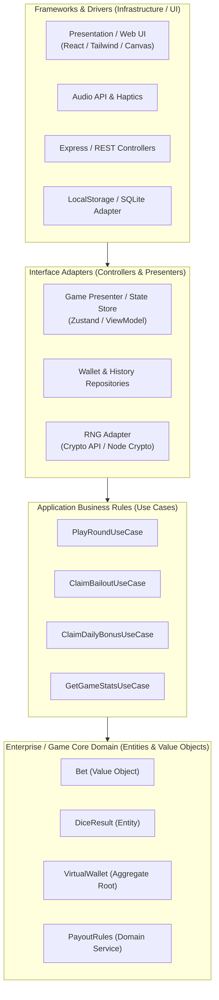
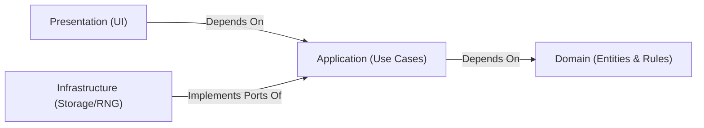
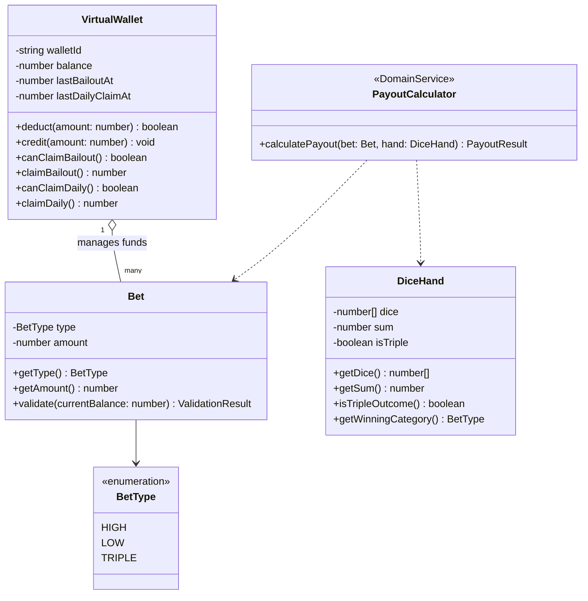

# เอกสารการออกแบบสถาปัตยกรรมซอฟต์แวร์ (Software Architecture Specification)
## ระบบ: มินิเกมง่าย ๆ แนวพนันไม่ลงเงินจริง (Play-Money Casual High-Low Mini-Game)

> **มาตรฐาน:** ดำเนินการวิเคราะห์และออกแบบตามทักษะ **03-software-architecture**  
> **อ้างอิงเอกสารเดิม:**  
> - [01-requirements.md](file:///srv/http/newAPP/docs/01-requirements.md)  
> - [02-system-design.md](file:///srv/http/newAPP/docs/02-system-design.md)  
> **ที่ตั้งโปรเจกต์:** `/srv/http/newAPP/`  
> **เวอร์ชัน:** 1.0.0  
> **สถานะ:** Approved for Implementation  

---

## 1. รูปแบบสถาปัตยกรรมที่เลือกใช้ (Architecture Style)

ระบบเลือกใช้ **Clean Architecture (Onion / Hexagonal Architecture)** ร่วมกับ **Modular Local-First Domain Design** 

### เหตุผลในการเลือก:
1. **Separation of Concerns:** แยกตรรกะของกฎกติกาเกม (Game Rules & Payout Calculation) ออกจากการเรนเดอร์ UI (CSS 3D / Audio) และโครงสร้างพื้นฐาน (Storage / HTTP API) อย่างเด็ดขาด
2. **Framework Agnostic:** Domain Logic สามารถรันและถูกทดสอบได้ 100% โดยไม่ต้องพึ่งพา React, Vue, Express หรือ Browser DOM (Pure TypeScript / JavaScript)
3. **Dual Execution Mode (Local-First & Client-Server):** ด้วยรูปแบบ Ports & Adapters ทำให้ Game Engine แกนกลางสามารถเสียบใช้ `ServerApiAdapter` (เมื่อมีเน็ตเพื่อตรวจสอบความโปร่งใส) หรือเสียบ `LocalStorageCryptoAdapter` (เมื่อเล่นออฟไลน์ Standalone) ได้โดยไม่ต้องแก้ไข Business Logic เลยแม้แต่บรรทัดเดียว



---

## 2. กฎการพึ่งพาและการแบ่งเลเยอร์ (Dependency Rules & Layer Structure)

### 2.1 The Dependency Rule
> **"การพึ่งพาของโค้ดต้องชี้เข้าสู่ศูนย์กลาง (Inward) เท่านั้น"**  
> เลเยอร์วงใน (Domain & Use Cases) จะต้องไม่รู้จักและไม่เรียกใช้ Class, Function หรือ Library จากเลเยอร์วงนอก (React, Axios, LocalStorage, SQLite) โดยเด็ดขาด



### 2.2 โครงสร้างโฟลเดอร์ของซอฟต์แวร์ (Project Directory Structure)

```text
/srv/http/newAPP/
├── docs/                                # เอกสารวิเคราะห์และออกแบบ
│   ├── 01-requirements.md
│   ├── 02-system-design.md
│   └── 03-software-architecture.md
├── src/
│   ├── domain/                          # [LAYER 1] แก่นธุรกิจบริสุทธิ์ (Pure TS, No external libs)
│   │   ├── entities/
│   │   │   ├── Bet.ts                   # Value Object: ตรวจสอบความถูกต้องของประเภทและยอดแทง
│   │   │   ├── DiceHand.ts              # Entity: ผลทอยเต๋า 3 ลูก, คำนวณผลรวม, ตรวจสอบเต๋าตอง
│   │   │   └── VirtualWallet.ts         # Aggregate Root: ดูแลยอดชิป, กฎการหัก/เติม, Bailout Guard
│   │   ├── services/
│   │   │   ├── PayoutCalculator.ts      # Domain Service: คำนวณอัตราจ่ายตาม BR-03
│   │   │   └── StreakTracker.ts         # Domain Service: คำนวณ Win Rate & Streak
│   │   └── ports/                       # Interfaces ที่ Domain/Use Cases ต้องการ
│   │       ├── IRandomGenerator.ts      # Port: สุ่มตัวเลขลูกเต๋า 1-6
│   │       ├── IWalletRepository.ts     # Port: บันทึก/อ่านยอดกระเป๋าชิป
│   │       └── IHistoryRepository.ts    # Port: บันทึก/อ่านประวัติรอบการเล่น
│   │
│   ├── application/                     # [LAYER 2] Use Cases (Orchestration ของงานแต่ละคำสั่ง)
│   │   ├── usecases/
│   │   │   ├── PlaceBetAndRoll.ts       # จัดการโฟลว์: หักชิป -> สุ่มเต๋า -> ตัดสินผล -> คืนชิป -> บันทึก
│   │   │   ├── ClaimEmergencyBailout.ts # จัดการโฟลว์ขอรับชิปฟรี 200 เมื่อชิปหมด (BR-04)
│   │   │   └── ClaimDailyReward.ts      # จัดการโฟลว์เคลมโบนัสประจำวัน 500 (BR-01)
│   │   └── dtos/
│   │       ├── PlayRoundDTO.ts          # Input/Output Contract สำหรับการเล่นรอบ
│   │       └── WalletStatusDTO.ts       # Data Transfer Object สำหรับแสดงสถานะกระเป๋า
│   │
│   ├── infrastructure/                  # [LAYER 3] การเชื่อมต่อภายนอก (Implement Ports)
│   │   ├── rng/
│   │   │   ├── WebCryptoRNG.ts          # สุ่มโดยใช้ window.crypto (Client-side)
│   │   │   └── NodeCryptoRNG.ts         # สุ่มโดยใช้ node:crypto (Server-side)
│   │   ├── storage/
│   │   │   ├── LocalStorageWalletRepo.ts# จัดการ Storage บนบราวเซอร์ พร้อม Checksum กันโกง
│   │   │   └── InMemoryWalletRepo.ts    # สำหรับรัน Unit Test ไร้ผลข้างเคียง
│   │   └── sound/
│   │       └── WebAudioService.ts       # สังเคราะห์/เล่นเสียง Roll, Win, Lose, Chip Click
│   │
│   └── presentation/                    # [LAYER 4] ส่วนติดต่อผู้ใช้ (UI & State)
│       ├── components/
│       │   ├── BetBoard.tsx             # กระดานเลือกแทง High/Low/Triple และชิป
│       │   ├── DiceCup3D.tsx            # ลูกเต๋า 3 มิติ CSS Transform & Animation
│       │   ├── WalletBar.tsx            # แถบแสดงชิป, ปุ่ม Bailout, ปุ่ม Daily Bonus
│       │   ├── HistoryRoadmap.tsx       # แถบ Roadmap แสดงผลย้อนหลัง 15 รอบ
│       │   └── DisclaimerModal.tsx      # ป้ายเตือนเพื่อความบันเทิง ไม่ใช่การพนันจริง
│       └── store/
│           └── useGameStore.ts          # State Manager (Zustand) ผูก Use Cases เข้ากับ UI
├── tests/
│   ├── unit/                            # ทดสอบ Domain Entities, Use Cases ไร้ UI
│   └── e2e/                             # ทดสอบการเล่นเกมจากมุมมองผู้ใช้
└── package.json
```

---

## 3. ขอบเขตของโดเมนและการจำลองโมเดล (Domain Boundaries & Modeling)



### 3.1 Bounded Contexts
1. **Wagering Context:** รับผิดชอบความถูกต้องของการวางเดิมพัน เช่น ยอดขั้นต่ำ (10 ชิป), ยอดสูงสุด (500 ชิป), และชนิดของการแทง (High/Low/Triple)
2. **Game Resolution Context:** รับผิดชอบการสุ่มลูกเต๋า (3 ลูก แต้ม 1-6) การประเมินแต้มรวม (Sum) การตัดสินผลตามกฎ House Edge และการคำนวณเงินรางวัล (Payout Multiplier)
3. **Virtual Economy Context:** ดูแลยอดคงเหลือในกระเป๋า (Balance), สิทธิ์การขอชิปฉุกเฉิน (Bailout Cooldown 60 วินาที), สิทธิ์การเคลมรายวัน (Daily Faucet 24 ชม.), และการันตีมูลค่าศูนย์ (Zero Economic Value)

---

## 4. อินเตอร์เฟซและข้อตกลงระหว่างโมดูล (Contracts & Ports)

### 4.1 Port: ตัวสร้างเลขสุ่ม (`IRandomGenerator`)
```typescript
// src/domain/ports/IRandomGenerator.ts
export interface IRandomGenerator {
  /**
   * สุ่มตัวเลขจำนวนเต็มระหว่าง min ถึง max (รวมทั้งสองฝั่ง)
   * ต้องมีความปลอดภัยสูงทางวิทยาการรหัสลับ (CSPRNG)
   */
  generateInt(min: number, max: number): number;

  /**
   * สุ่มแต้มลูกเต๋า 3 ลูก (แต้ม 1 ถึง 6)
   */
  rollDiceHand(): [number, number, number];
}
```

### 4.2 Port: ที่เก็บข้อมูลกระเป๋าชิป (`IWalletRepository`)
```typescript
// src/domain/ports/IWalletRepository.ts
import { VirtualWallet } from '../entities/VirtualWallet';

export interface IWalletRepository {
  getWallet(): Promise<VirtualWallet>;
  saveWallet(wallet: VirtualWallet): Promise<void>;
  resetWallet(): Promise<VirtualWallet>;
}
```

### 4.3 Use Case Interface: การเล่นเกมแต่ละรอบ (`IPlaceBetAndRoll`)
```typescript
// src/application/dtos/PlayRoundDTO.ts
export type BetOption = 'HIGH' | 'LOW' | 'TRIPLE';

export interface PlayRoundInput {
  betOption: BetOption;
  betAmount: number;
}

export interface PlayRoundOutput {
  dice: [number, number, number];
  sum: number;
  isTriple: boolean;
  won: boolean;
  payoutAmount: number;
  netGain: number;
  newBalance: number;
  message: string;
}
```

---

## 5. การบังคับใช้หลักการ SOLID และ Separation of Concerns

1. **Single Responsibility Principle (SRP):**
   - `DiceHand` สนใจแค่แต้มเต๋าและการคำนวณผลรวม ไม่ยุ่งเกี่ยวกับเงินรางวัล
   - `PayoutCalculator` สนใจแค่อัตราคูณและการจับคู่ผลแพ้ชนะ ไม่ยุ่งเกี่ยวกับการหักเงินในกระเป๋า
   - `VirtualWallet` สนใจแค่กฎการเพิ่ม/ลดยอดชิปและเวลาคูลดาวน์ ไม่รับรู้ว่าเงินนั้นมาจากเกมใด
2. **Open/Closed Principle (OCP):**
   - หากต้องการเพิ่มประเภทการแทงใหม่ในอนาคต (เช่น แทงคู่-คี่ Even-Odd หรือแทงแต้มรวมเฉพาะเจาะจง) สามารถขยาย `PayoutCalculator` และเพิ่ม enum `BetType` โดยไม่ต้องแก้โครงสร้าง `VirtualWallet`
3. **Liskov Substitution Principle (LSP):**
   - `WebCryptoRNG` และ `NodeCryptoRNG` สามารถสลับทดแทนกันได้ผ่าน `IRandomGenerator` โดยไม่ส่งผลกระทบต่อตรรกะของ `PlaceBetAndRollUseCase`
4. **Interface Segregation Principle (ISP):**
   - แยก `IRandomGenerator`, `IWalletRepository`, `IHistoryRepository` ออกเป็นสัญญาเฉพาะด้าน ไม่มัดรวมเป็น God Interface ตัวเดียว
5. **Dependency Inversion Principle (DIP):**
   - คลาส Use Case ไม่เรียกใช้ `localStorage` โดยตรง แต่เรียกใช้ผ่าน `IWalletRepository` ทำให้สามารถเปลี่ยนเป็น IndexedDB, In-Memory, หรือ REST API ได้อย่างอิสระ

---

## 6. บันทึกการตัดสินใจทางสถาปัตยกรรม (Architecture Decision Records - ADR)

### ADR-001: การเลือกใช้ Clean Architecture ร่วมกับ Domain-Driven Design ขนาดเล็ก
- **สถานะ:** Accepted
- **บริบท:** มินิเกมแนวเสี่ยงทายมักเผชิญปัญหา Logic การตัดสินผลและเงินรางวัลไปปะปนกับโค้ดฝั่ง UI (เช่น ไปเขียนไว้ในปุ่ม React `onClick`) ทำให้ยากต่อการทดสอบ Unit Test และเกิดบั๊กเรื่องยอดชิปติดลบ
- **การตัดสินใจ:** แบ่งโค้ดออกเป็น 4 เลเยอร์ (Domain, Application, Infrastructure, Presentation) โดยให้ Domain เป็น Pure TypeScript ไร้ Framework ใดๆ
- **ผลลัพธ์:** สามารถเขียน Automated Unit Tests ครอบคลุมกฎกติกาเกมได้ 100% โดยไม่ต้องเปิด Browser และทำให้ Codebase สะอาด เป็นระเบียบ

---

### ADR-002: การใช้อินเตอร์เฟซ CSPRNG เพื่อรองรับทั้ง Client-Only และ Client-Server
- **สถานะ:** Accepted
- **บริบท:** ในช่วงเริ่มต้น ระบบเน้นความรวดเร็วและประหยัดค่าใช้จ่าย จึงต้องการรันบน Browser ได้ทันที แต่ในอนาคตอาจต้องขยายเป็น Server API เพื่อทำ Leaderboard กลาง
- **การตัดสินใจ:** สร้าง Port `IRandomGenerator` โดยตัวเริ่มต้นใช้ Web Crypto API (`window.crypto.getRandomValues`) ซึ่งเป็น True Random ป้องกันการเดา Seed ของ `Math.random()` และพร้อมสลับไปใช้ Server REST RNG เมื่อเปิดใช้งานโหมดออนไลน์
- **ผลลัพธ์:** ปลอดภัยสูง กติกาเป็นธรรม (Provably Unbiased) และยืดหยุ่นต่อการต่อขยาย

---

### ADR-003: กลไก Client-side State Protection ด้วย Checksum Salt
- **สถานะ:** Accepted
- **บริบท:** ในโหมดเล่นผ่าน Browser ผู้เล่นอาจพยายามเปิด DevTools เพื่อแก้ไข `localStorage.setItem('chips', 9999999)`
- **การตัดสินใจ:** เมื่อจัดเก็บลง LocalStorage ให้เก็บข้อมูลคู่กับ HMAC/Checksum Hash (คำนวณจาก `balance + lastDailyClaimAt + secretSalt`) หากผู้ใช้แอบแก้ตัวเลขใน LocalStorage ตรงๆ Checksum จะไม่ตรง และระบบจะกู้คืนค่า Balance กลับเป็น Default ทันที
- **ผลลัพธ์:** ป้องกันการโกงระดับพื้นฐาน (Casual Tampering) ได้อย่างมีประสิทธิภาพโดยไม่ต้องพึ่งพาเซิร์ฟเวอร์ราคาแพง

---

## 7. จุดเสี่ยงทางสถาปัตยกรรมและมาตรการป้องกัน (Architecture Risks)

| จุดเสี่ยง (Risk Area) | สิ่งที่อาจเกิดขึ้น (Code Smell / Pitfall) | มาตรการป้องกันในเชิงสถาปัตยกรรม (Mitigation) |
| :--- | :--- | :--- |
| **Logic Leaks to UI** | นักพัฒนาแอบเขียนเงื่อนไข Payout ใน Component `BetBoard.tsx` | กำหนดให้ Component สื่อสารผ่าน Zustand Action ซึ่งจะเรียกตรงไปที่ Use Case เท่านั้น ห้ามมี Math Logic ใน JSX |
| **Race Condition on Roll** | ผู้เล่นกดทอยเต๋าซ้ำๆ ขณะที่อนิเมชันกำลังเล่น ทำให้หักชิปเบิ้ล | State ใน Store มีสถานะ `isRolling: boolean` เมื่อเป็น `true` Use Case จะปฏิเสธคำสั่งใหม่ทันที |
| **Floating Point Inaccuracies** | การคูณอัตราจ่ายอาจทำให้เกิดจุดทศนิยมแปลกๆ (เช่น 10.0000000000004) | บังคับให้หน่วยชิปทั้งหมดเป็น **Integer (จำนวนเต็ม)** ตลอดทั้ง Domain ห้ามใช้ทศนิยมในการแทงหรือจ่ายรางวัล |

---

## 8. แผนการตรวจสอบและการนำไปใช้งาน (Verification & Next Steps)

1. **การตรวจสอบความถูกต้องของสถาปัตยกรรม (Verification):**
   - โค้ดใน `src/domain/` ต้องไม่มีคำสั่ง `import` ใดๆ ที่มาจาก React, DOM, หรือ External Libraries
   - สามารถรัน Unit Test ทดสอบ `PlaceBetAndRollUseCase` ได้ผ่านคำสั่ง test ภายในเวลา < 1 วินาที
2. **เชื่อมโยงสู่ Skill ถัดไป:**
   - **Skill 04 (Database Design):** ออกแบบ Entity Schema และ Storage Model ให้สอดคล้องกับ `IWalletRepository` และ `IHistoryRepository`
   - **Skill 05 (API Design):** ออกแบบ REST Endpoints สำหรับเชื่อม Use Cases กรณีต้องการเปิดรัน Backend Service
