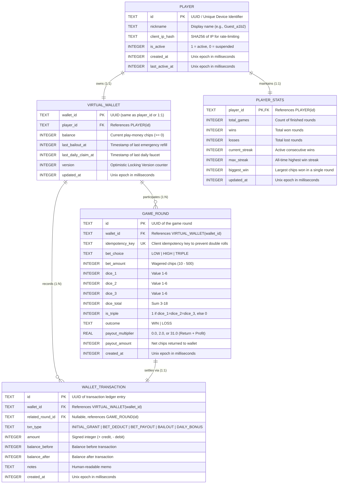
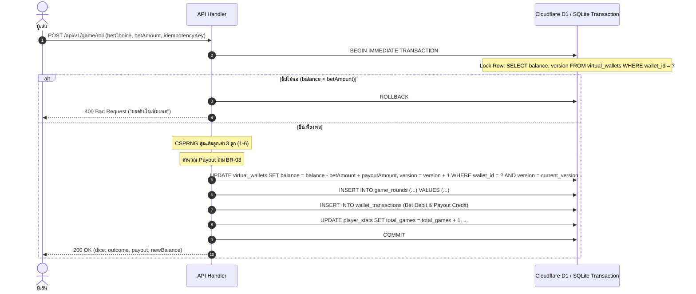

# เอกสารการออกแบบฐานข้อมูล (Database Design Specification)
## ระบบ: มินิเกมง่าย ๆ แนวพนันไม่ลงเงินจริง (Play-Money Casual High-Low Mini-Game)

> **มาตรฐาน:** ดำเนินการออกแบบตามทักษะ **04-database-design**  
> **อ้างอิงเอกสารเดิม:**  
> - [01-requirements.md](01-requirements.md)  
> - [02-system-design.md](02-system-design.md)  
> - [03-software-architecture.md](03-software-architecture.md)  
> **ฐานข้อมูลเป้าหมาย:** SQLite / Cloudflare D1 (Serverless Edge SQL) & PostgreSQL Ready  
> **เวอร์ชัน:** 1.0.0  
> **สถานะ:** Approved for Implementation  

---

## 1. การจำลองข้อมูลและแผนภาพความสัมพันธ์ (Entity-Relationship Diagram - ERD)

โครงสร้างฐานข้อมูลออกแบบตามหลักการ **Play-Money Virtual Economy** และ **Append-Only Ledger for Auditability** เพื่อให้ทุกการเคลื่อนไหวของชิปคะแนนสามารถสอบทานได้ ไม่สูญหาย และทนทานต่อ Race Condition



---

## 2. นิยามโครงสร้างตาราง (Table Definitions & DDL)

DDL รองรับ **Cloudflare D1 (SQLite Engine)** และเข้ากันได้กับ ANSI SQL (PostgreSQL/MySQL):

```sql
-- 1. ตารางข้อมูลผู้เล่น (Players / Sessions)
CREATE TABLE IF NOT EXISTS players (
    id TEXT PRIMARY KEY,
    nickname TEXT NOT NULL,
    client_ip_hash TEXT,
    is_active INTEGER NOT NULL DEFAULT 1 CHECK (is_active IN (0, 1)),
    created_at INTEGER NOT NULL,
    last_active_at INTEGER NOT NULL
);

-- 2. ตารางกระเป๋าชิปจำลอง (Virtual Wallet)
CREATE TABLE IF NOT EXISTS virtual_wallets (
    wallet_id TEXT PRIMARY KEY,
    player_id TEXT NOT NULL UNIQUE,
    balance INTEGER NOT NULL DEFAULT 1000 CHECK (balance >= 0),
    last_bailout_at INTEGER NOT NULL DEFAULT 0,
    last_daily_claim_at INTEGER NOT NULL DEFAULT 0,
    version INTEGER NOT NULL DEFAULT 1,
    updated_at INTEGER NOT NULL,
    FOREIGN KEY (player_id) REFERENCES players(id) ON DELETE CASCADE
);

-- 3. ตารางสถิติผู้เล่น (Player Statistics)
CREATE TABLE IF NOT EXISTS player_stats (
    player_id TEXT PRIMARY KEY,
    total_games INTEGER NOT NULL DEFAULT 0 CHECK (total_games >= 0),
    wins INTEGER NOT NULL DEFAULT 0 CHECK (wins >= 0),
    losses INTEGER NOT NULL DEFAULT 0 CHECK (losses >= 0),
    current_streak INTEGER NOT NULL DEFAULT 0 CHECK (current_streak >= 0),
    max_streak INTEGER NOT NULL DEFAULT 0 CHECK (max_streak >= 0),
    biggest_win INTEGER NOT NULL DEFAULT 0 CHECK (biggest_win >= 0),
    updated_at INTEGER NOT NULL,
    FOREIGN KEY (player_id) REFERENCES players(id) ON DELETE CASCADE
);

-- 4. ตารางบันทึกรอบเกม (Game Rounds)
CREATE TABLE IF NOT EXISTS game_rounds (
    id TEXT PRIMARY KEY,
    wallet_id TEXT NOT NULL,
    idempotency_key TEXT NOT NULL UNIQUE,
    bet_choice TEXT NOT NULL CHECK (bet_choice IN ('LOW', 'HIGH', 'TRIPLE')),
    bet_amount INTEGER NOT NULL CHECK (bet_amount >= 10 AND bet_amount <= 500),
    dice_1 INTEGER NOT NULL CHECK (dice_1 BETWEEN 1 AND 6),
    dice_2 INTEGER NOT NULL CHECK (dice_2 BETWEEN 1 AND 6),
    dice_3 INTEGER NOT NULL CHECK (dice_3 BETWEEN 1 AND 6),
    dice_total INTEGER NOT NULL CHECK (dice_total BETWEEN 3 AND 18),
    is_triple INTEGER NOT NULL CHECK (is_triple IN (0, 1)),
    outcome TEXT NOT NULL CHECK (outcome IN ('WIN', 'LOSS')),
    payout_multiplier REAL NOT NULL CHECK (payout_multiplier >= 0.0),
    payout_amount INTEGER NOT NULL DEFAULT 0 CHECK (payout_amount >= 0),
    created_at INTEGER NOT NULL,
    FOREIGN KEY (wallet_id) REFERENCES virtual_wallets(wallet_id) ON DELETE RESTRICT
);

-- 5. ตารางบัญชีแยกประเภทความเคลื่อนไหวชิป (Virtual Chip Ledger / Transactions)
CREATE TABLE IF NOT EXISTS wallet_transactions (
    id TEXT PRIMARY KEY,
    wallet_id TEXT NOT NULL,
    related_round_id TEXT,
    txn_type TEXT NOT NULL CHECK (txn_type IN ('INITIAL_GRANT', 'BET_DEDUCT', 'BET_PAYOUT', 'BAILOUT', 'DAILY_BONUS', 'RESET')),
    amount INTEGER NOT NULL,
    balance_before INTEGER NOT NULL CHECK (balance_before >= 0),
    balance_after INTEGER NOT NULL CHECK (balance_after >= 0),
    notes TEXT,
    created_at INTEGER NOT NULL,
    FOREIGN KEY (wallet_id) REFERENCES virtual_wallets(wallet_id) ON DELETE RESTRICT,
    FOREIGN KEY (related_round_id) REFERENCES game_rounds(id) ON DELETE SET NULL
);
```

---

## 3. พจนานุกรมข้อมูล (Data Dictionary)

### 3.1 `virtual_wallets`
| Column | Type | Nullable | Default | Description |
| :--- | :--- | :--- | :--- | :--- |
| `wallet_id` | TEXT | NO | - | Primary Key รหัสกระเป๋าชิป (UUID v4) |
| `player_id` | TEXT | NO | - | Foreign Key ชี้ไปยังผู้เล่น เจ้าของกระเป๋า |
| `balance` | INTEGER | NO | 1000 | ยอดชิปคงเหลือปัจจุบัน มีเงื่อนไข `>= 0` ป้องกันยอดติดลบ |
| `last_bailout_at` | INTEGER | NO | 0 | เวลาที่กดรับชิปช่วยเหลือกู้ชีพ 200 ชิปล่าสุด (Epoch ms) |
| `last_daily_claim_at` | INTEGER | NO | 0 | เวลาที่กดรับโบนัสล็อกอินรายวัน 500 ชิปล่าสุด (Epoch ms) |
| `version` | INTEGER | NO | 1 | ตัวนับเวอร์ชันสำหรับ Optimistic Concurrency Control |
| `updated_at` | INTEGER | NO | - | เวลาที่ข้อมูลถูกอัปเดตล่าสุด |

### 3.2 `game_rounds`
| Column | Type | Nullable | Default | Description |
| :--- | :--- | :--- | :--- | :--- |
| `id` | TEXT | NO | - | Primary Key รหัสรอบเกม (UUID v4) |
| `wallet_id` | TEXT | NO | - | FK กระเป๋าชิปของผู้เล่นที่ลงเดิมพัน |
| `idempotency_key` | TEXT | NO | - | คีย์ป้องกันการส่งซ้ำจากการกดเบิ้ล (Unique Constraint) |
| `bet_choice` | TEXT | NO | - | หน้าเดิมพัน: 'LOW', 'HIGH', หรือ 'TRIPLE' |
| `bet_amount` | INTEGER | NO | - | ยอดชิปเดิมพัน (10 ถึง 500) |
| `dice_1`, `dice_2`, `dice_3` | INTEGER | NO | - | แต้มลูกเต๋าลูกที่ 1, 2 และ 3 (1-6) |
| `dice_total` | INTEGER | NO | - | ผลรวมแต้มลูกเต๋า 3 ลูก (3-18) |
| `is_triple` | INTEGER | NO | 0 | แฟล็กแต้มตอง: 1 = ออกตอง, 0 = ไม่ออกตอง |
| `outcome` | TEXT | NO | - | ผลตัดสิน: 'WIN' หรือ 'LOSS' |
| `payout_multiplier` | REAL | NO | - | ตัวคูณรางวัล (0.0 = แพ้, 2.0 = Low/High ชนะ, 31.0 = Triple ชนะ) |
| `payout_amount` | INTEGER | NO | 0 | ยอดชิปที่จ่ายคืนเข้ากระเป๋าจริง |
| `created_at` | INTEGER | NO | - | วันเวลาที่เล่นรอบนี้ |

---

## 4. กลยุทธ์การสร้างดัชนี (Index Strategy)

การสร้าง Index ออกแบบจากพฤติกรรมการสืบค้นข้อมูลจริง (Query Patterns) ของผู้ใช้งานในแอป:

```sql
-- Pattern 1: ดึงผลย้อนหลัง 15-20 รอบของ Roadmap (FR-12)
-- Query: SELECT bet_choice, dice_1, dice_2, dice_3, dice_total, outcome, created_at 
--        FROM game_rounds WHERE wallet_id = ? ORDER BY created_at DESC LIMIT 20;
CREATE INDEX IF NOT EXISTS idx_game_rounds_wallet_created 
ON game_rounds (wallet_id, created_at DESC);

-- Pattern 2: ป้องกัน Duplicate Roll ผ่าน Idempotency Key ทันที
-- Query: SELECT id FROM game_rounds WHERE idempotency_key = ?;
CREATE UNIQUE INDEX IF NOT EXISTS uq_game_rounds_idempotency 
ON game_rounds (idempotency_key);

-- Pattern 3: ตรวจสอบ Ledger History และยอดเงินย้อนหลัง
-- Query: SELECT * FROM wallet_transactions WHERE wallet_id = ? ORDER BY created_at DESC LIMIT 50;
CREATE INDEX IF NOT EXISTS idx_wallet_txns_wallet_created 
ON wallet_transactions (wallet_id, created_at DESC);

-- Pattern 4: ค้นหาผู้เล่นที่กำลัง Active ในช่วง 24 ชั่วโมง
CREATE INDEX IF NOT EXISTS idx_players_last_active 
ON players (last_active_at DESC);
```

---

## 5. ขอบเขตทรานแซกชันและความสอดคล้องของข้อมูล (Transaction Boundaries)

เพื่อให้สอดคล้องตามคุณสมบัติ **ACID** ทุกรอบการเล่น (Game Round) จะต้องถูกประมวลผลอยู่ภายใต้ **Single Database Transaction** เพื่อป้องกันสภาวะชิปหายหรือชิปงอกเมื่อระบบขัดข้อง:



### กฎความปลอดภัยทางธุรกรรม (Transaction Rules):
1. **Balance Non-Negativity:** ใช้ Database Constraint `CHECK (balance >= 0)` ร่วมกับ SQL Atomicity ป้องกันการแข่งขันหักเงิน (Race Conditions) ยอดชิปจะไม่มีวันติดลบ
2. **Optimistic Locking:** ตาราง `virtual_wallets` มีคอลัมน์ `version` เพื่อตรวจสอบการชนกันของคำสั่งพร้อมกัน
3. **Idempotency Guard:** หากมีการส่งคำขอซ้ำด้วย `idempotency_key` เดิม ระบบจะตอบกลับด้วยผลลัพธ์รอบเดิมทันทีโดยไม่หักชิปซ้ำ

---

## 6. แผนการอัปเกรดและการย้อนกลับ (Migration & Rollback Plan)

### โครงสร้างโฟลเดอร์ Migration
```text
migrations/
├── 0001_initial_schema.sql         # Base Tables (players, wallets, stats, rounds, txns)
├── 0002_add_indexes.sql            # Performance Query Indexes
└── 0001_rollback.sql               # Clean Drop Script (for dev/testing rollback)
```

### คำสั่งการรัน Migration (Cloudflare D1 / Local SQLite):
```bash
# ทดสอบรัน Migration บน Local SQLite
bun run db:migrate:local

# สั่ง Execute บน Cloudflare D1 Production ผ่าน Wrangler
npx wrangler d1 execute mini-casino-db --file=./migrations/0001_initial_schema.sql
npx wrangler d1 execute mini-casino-db --file=./migrations/0002_add_indexes.sql
```

---

## 7. การประเมินความเสี่ยงด้านประสิทธิภาพ (Performance & Scalability Risks)

| ความเสี่ยง | สาเหตุที่อาจเกิด | ผลกระทบ | มาตรการป้องกัน/แก้ไข |
| :--- | :--- | :--- | :--- |
| **D1 Write Bottleneck** | SQLite มี Single-writer Architecture หากมีผู้เล่นกด Roll พร้อมกันหลายร้อยคนในเสี้ยววินาที | คำขอคิวรอนาน (Queue Timeout) | ใช้ Batch Transactions, ปรับคิวการเขียนที่ Cloudflare Worker Layer, และทำ Caching ข้อมูล Stats |
| **Table Growth (Ledger)** | ตาราง `wallet_transactions` และ `game_rounds` มีขนาดโตเร็วมากตามจำนวนรอบการเล่น | การ Query ประวัติช้าลง และเปลือง Storage | ทำ Auto-archiving ประวัติที่เก่าเกิน 30 วันไปไว้ใน Cloudflare R2 หรือ Object Storage |
| **Device Storage Limit** | กรณีโหมด Standalone LocalStorage มีขีดจำกัดประมาณ 5MB ต่อโดเมน | ประวัติรอบการเล่นล้นหน่วยความจำเครื่อง | ทำ FIFO Truncation จำกัดประวัติใน LocalStorage ไว้ที่ 50 รอบล่าสุดเสมอ |
