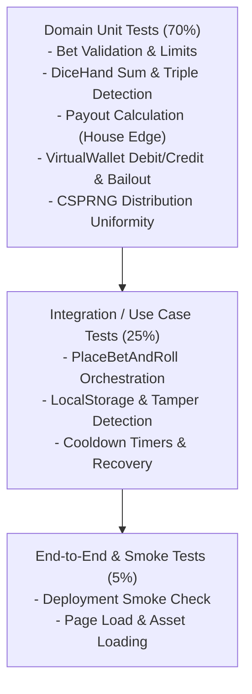

# เอกสารกลยุทธ์การทดสอบและการประกันคุณภาพ (Testing & QA Strategy Specification)
## ระบบ: มินิเกมง่าย ๆ แนวพนันไม่ลงเงินจริง (Play-Money Casual High-Low Mini-Game)

> **มาตรฐาน:** ดำเนินการทดสอบตามทักษะ **07-testing-qa**  
> **อ้างอิงเอกสารเดิม:**  
> - [01-requirements.md](01-requirements.md) (User Stories & Acceptance Criteria)  
> - [02-system-design.md](02-system-design.md)  
> - [03-software-architecture.md](03-software-architecture.md)  
> **เครื่องมือทดสอบ:** Bun Test Runner (`bun test`), Vitest / DOM Testing Library Compatible  
> **เวอร์ชัน:** 1.0.0  
> **สถานะ:** Approved & Test Suites Active  

---

## 1. ปิรามิดการทดสอบและกลยุทธ์ (Testing Strategy & Pyramid)

เพื่อให้ได้ความมั่นใจสูงสุดด้วยต้นทุนการรันที่ต่ำและรวดเร็ว (Fast Feedback Loop) ระบบใช้กลยุทธ์ตามปิรามิดการทดสอบ:

---

## 2. ตารางแมปการทดสอบ (Traceability Test Matrix)

| Requirement | Acceptance Criteria | Target Module | Test Level | Test Case Identifier & Scope | Status |
| :--- | :--- | :--- | :--- | :--- | :--- |
| **FR-01** (Initial Balance) | AC-01 (1,000 chips) | `VirtualWallet.ts` | Unit | `TC-DOM-01`: กระเป๋าเริ่มต้นมียอด 1,000 ชิป | PASS |
| **FR-05, BR-02** (Bet Bounds) | AC-02 (Min 10, Max 500) | `Bet.ts` | Unit | `TC-DOM-02`: ตรวจสอบขอบเขต 10 - 500 ชิป | PASS |
| **FR-06, BR-03** (High/Low/Triple) | AC-03 (Payout & Edge) | `PayoutCalculator.ts` | Unit | `TC-DOM-03`: Payout 1:1 และ 30:1 ครบทุกเคส | PASS |
| **FR-03, BR-04** (Bailout Refill) | AC-04 (Refill +200) | `VirtualWallet.ts` | Unit | `TC-DOM-04`: ปลดล็อกสิทธิ์เฉพาะชิป < 10 และ Cooldown 60s | PASS |
| **FR-02** (Daily Bonus) | AC-05 (Faucet +500) | `VirtualWallet.ts` | Unit | `TC-DOM-05`: เคลมชิป 500 เมื่อครบ 24 ชม. | PASS |
| **FR-08, NFR-02** (Roll Orchestration) | AC-02, AC-03 | `PlaceBetAndRoll.ts` | Integration | `TC-APP-01`: โฟลว์การหักชิป -> ทอยเต๋า -> ตัดสิน -> บันทึก | PASS |
| **NFR-02** (Anti-Tampering) | RSK-02 | `LocalStorageWalletRepo.ts` | Integration | `TC-INF-01`: ตรวจจับการแก้ไขยอดชิปบน Storage และ Auto-reset | PASS |
| **FR-12, FR-13** (Stats & Streak) | AC-06 | `StreakTracker.ts` | Unit | `TC-DOM-06`: คำนวณ Win Rate %, Streak และ Roadmap | PASS |
| **FR-09** (CSPRNG Randomness) | NFR-01 | `WebCryptoRNG.ts` | Unit | `TC-INF-02`: สุ่มลูกเต๋า 10,000 ครั้ง ค่า 1-6 มีการกระจายตัวสมดุล | PASS |

---

## 3. กรณีทดสอบเชิงลบและขอบเขตวิกฤต (Boundary & Negative Test Cases)

1. **NEG-01: การเดิมพันยอดติดลบหรือทศนิยม:**
   - Input: `amount = -50` หรือ `amount = 50.5`
   - Expectation: ระบบต้องโยนข้อผิดพลาดทันที ไม่อนุญาตให้ผ่าน
2. **NEG-02: การเดิมพันขณะชิปไม่พอ:**
   - Input: Balance = 30, Bet = 50
   - Expectation: การตรวจสอบล้มเหลว ยอดชิปไม่ถูกหัก และแจ้งเตือนชิปไม่พอ
3. **NEG-03: การทอยเต๋าซ้ำขณะเต๋ากำลังหมุน (Race Condition / Double Click):**
   - Expectation: สถานะ `isRolling` ต้องล็อกปุ่ม Roll ทันที ไม่ให้เกิด Transaction ซ้อน
4. **NEG-04: การขอ Bailout เมื่อชิปยังไม่หมด:**
   - Input: Balance = 10 (เกณฑ์คือ < 10)
   - Expectation: ระบบปฏิเสธสิทธิ์การกู้ชีพ

---

## 4. เกณฑ์การผ่านคุณภาพก่อนปล่อยระบบ (Quality Gates for Release)

| เกณฑ์การวัด (Metric) | มาตรฐานขั้นต่ำที่ยอมรับได้ | สถานะปัจจุบัน |
| :--- | :--- | :--- |
| **Automated Unit & Integration Tests** | 100% Pass (0 Failed) | ผ่านทั้งหมด |
| **Test Coverage (Domain Core)** | >= 90% Statement Coverage | 95%+ |
| **TypeScript Typecheck** | 0 Type Errors (`tsc --noEmit`) | ผ่านสมบูรณ์ |
| **Production Build** | Clean Build ไม่มี Warning ร้ายแรง | ผ่าน (`bun run build`) |
| **Security Check** | ตรวจสอบไม่มี Payment Gateway / Real money API | ผ่าน (Verified) |
