# เอกสารไปป์ไลน์การส่งมอบและการดำเนินงานระบบ (DevOps & CI/CD Specification)
## ระบบ: มินิเกมง่าย ๆ แนวพนันไม่ลงเงินจริง (Play-Money Casual High-Low Mini-Game)

> **มาตรฐาน:** ดำเนินการออกแบบและตรวจสอบตามทักษะ **10-devops-cicd**  
> **อ้างอิงเอกสารเดิม:**  
> - [01-requirements.md](01-requirements.md)  
> - [02-system-design.md](02-system-design.md)  
> - [07-testing-qa.md](07-testing-qa.md)  
> **โครงสร้างพื้นฐานเป้าหมาย:** Cloudflare Pages (Edge CDN) + GitHub Actions CI/CD  
> **เวอร์ชัน:** 1.0.0  
> **สถานะ:** Active Pipeline Operational  

---

## 1. แผนผังไปป์ไลน์การส่งมอบอัตโนมัติ (Automated Delivery Pipeline Architecture)

```mermaid
flowchart LR
    Dev["Developer Push<br/>to master"] --> CI["GitHub Actions Runner"]
    
    subgraph QualityGates["Stage 1: Validation & Quality Gates"]
        Checkout["1. Checkout & Setup Bun"]
        Install["2. Dependency Install (Frozen)"]
        Typecheck["3. TypeScript Typecheck"]
        Test["4. Automated Unit Tests (bun test)"]
        Audit["5. Security & Secret Audit"]
    end

    subgraph BuildStage["Stage 2: Deterministic Build"]
        Build["6. Vite Production Build (dist/)"]
    end

    subgraph DeployStage["Stage 3: Zero-Downtime Deployment"]
        Deploy["7. Cloudflare Pages Deploy (Wrangler)"]
        HealthCheck["8. Smoke Test & Post-Deploy Verification"]
    end

    CI --> Checkout --> Install --> Typecheck --> Test --> Audit --> Build --> Deploy --> HealthCheck
```



---

## 2. ขั้นตอนและเกณฑ์คุณภาพในไปป์ไลน์ (Pipeline Stages & Quality Gates)

### Stage 1: Validation & Quality Assurance (Pre-commit / CI)
1. **Dependency Integrity:** ตรวจสอบความถูกต้องของแพ็กเกจด้วย `bun install --frozen-lockfile`
2. **Type Safety:** ตรวจสอบโครงสร้างภาษา TypeScript ด้วย `bun x tsc --noEmit`
3. **Automated Test Suite:** รันชุดทดสอบความถูกต้องของกฎธุรกิจและ Use Cases ทั้งหมดด้วย `bun test` หากมีเคสล้มเหลวแม้แต่ 1 เคส ไปป์ไลน์จะหยุดทำงานทันที (Fail Fast)
4. **Security Scan:** ตรวจสอบว่าไม่มี API Token หรือรหัสลับส่วนบุคคลหลุดเข้าไปใน Repository

### Stage 2: Production Artifact Compilation
1. คอมไพล์ซอร์สโค้ดและ Assets ผ่าน Vite: `bun run build`
2. สร้าง Production Bundle ในโฟลเดอร์ `dist/` ซึ่งประกอบด้วย HTML, Minified JS, Optimized CSS และ Web Audio Assets

### Stage 3: Edge CDN Deployment & Verification
1. ส่งมอบไฟล์ผ่าน `cloudflare/wrangler-action@v3` ไปยังโปรเจกต์ `mini-casino-game` บน Cloudflare Pages
2. เครือข่าย Anycast CDN ของ Cloudflare กระจายแคชไปยังดาต้าเซ็นเตอร์กว่า 300 แห่งทั่วโลกในเวลาไม่เกิน 5 วินาที
3. ทำ Post-deploy HTTP Status Check (ตรวจสอบรหัส 200 OK)

---

## 3. กลยุทธ์คอนเทนเนอร์สำหรับการพัฒนาในเครื่อง (Docker Container Strategy)

เพื่อให้นักพัฒนาหรือระบบ CI/CD สามารถรันและทดสอบระบบได้ในสภาพแวดล้อมที่เหมือนกันทุกประการ (Environment Parity) จึงได้จัดเตรียม `Dockerfile` แบบ Multi-stage Build:

```dockerfile
# Stage 1: Build
FROM oven/bun:latest AS builder
WORKDIR /app
COPY package.json bun.lock tsconfig.json vite.config.ts ./
RUN bun install --frozen-lockfile
COPY . .
RUN bun test && bun run build

# Stage 2: Production Lightweight Web Server
FROM nginx:alpine AS runner
COPY --from=builder /app/dist /usr/share/nginx/html
COPY public/_headers /usr/share/nginx/html/_headers
EXPOSE 80
CMD ["nginx", "-g", "daemon off;"]
```

---

## 4. แผนการจัดการความลับและการย้อนกลับ (Secrets & Rollback Strategy)

### 4.1 Secrets Management
- จัดเก็บความลับ `CLOUDFLARE_API_TOKEN` และ `CLOUDFLARE_ACCOUNT_ID` ไว้ใน GitHub Secrets เท่านั้น
- ห้ามใส่ Token ใดๆ ในโค้ดหรือไฟล์ `.env` ที่ถูก commit ขึ้น Git

### 4.2 กลยุทธ์การ Rollback (Instant Rollback Plan)
- สถาปัตยกรรมของ Cloudflare Pages มีระบบ **Atomic Versioned Deployments**
- หากพบปัญหาบน Production สามารถกดปุ่ม **"Rollback to this deployment"** บน Cloudflare Dashboard หรือสั่งคำสั่ง Wrangler CLI เพื่อสลับทราฟฟิกกลับไปยังเวอร์ชันก่อนหน้าได้ใน **เวลา < 1 วินาที (Instant Rollback)** โดยไม่ต้อง build ซ้ำ
